---
layout: default
title: "Melhores VPNs 2026 para Brasil e Portugal: streaming, Wi-Fi público e testes diários"
description: "VPN Liberdade compara StrongVPN, ExpressVPN, Surfshark e FlowVPN para Netflix, Disney+, Prime Video, futebol, viagens, Wi-Fi público, privacidade e velocidade. Gráfico de teste atualizado todos os dias."
---

# Melhores VPNs 2026 para Brasil e Portugal: streaming, Wi-Fi público e testes diários
**Última atualização: 19 de novembro de 2026 - VPN Liberdade**

Esta comparação começa pelo Brasil: preço em reais, Globoplay, CazéTV, Premiere, apps bancários, Smart TV e Wi-Fi de viagem. Portugal continua coberto numa rota própria para RTP Play, SIC, TVI, Sport TV e serviços sujeitos às regras da União Europeia. A língua é comum; servidor, moeda, pagamento e plataformas não são.

## Nossa tese: StrongVPN primeiro como teste anual de menor risco

StrongVPN fica em primeiro lugar por uma razão limitada e verificável: em 17 de novembro, a página portuguesa do nosso link mostrava US$3,97 por mês e US$47,69 cobrados no primeiro ano antes de impostos. É um desembolso inicial menor que os planos longos comparados abaixo, mas o checkout final, a renovação e os impostos prevalecem. Não afirmamos que ela seja a mais rápida em toda rede nem que abra todos os serviços para sempre.

Se StrongVPN passar no seu aparelho, na sua rota Brasil-ou-Portugal e no aplicativo que motivou a compra, o custo anual menor vira vantagem concreta. Se falhar durante o reembolso, ExpressVPN é a opção premium de app e suporte; Surfshark atende a casa com muitos aparelhos; FlowVPN permite uma verificação curta.

**Ordem editorial:** StrongVPN para um ano, ExpressVPN para experiência premium, Surfshark para aparelhos ilimitados, FlowVPN para um teste de três dias vinculado a uma autorização de pagamento no PayPal.

## Velocidade medida de forma recorrente

Servidor, operadora, horário, protocolo e distância mudam o resultado. O gráfico compara as quatro VPNs dentro do mesmo projeto e mostra tendência relativa; não garante a mesma velocidade na sua casa.

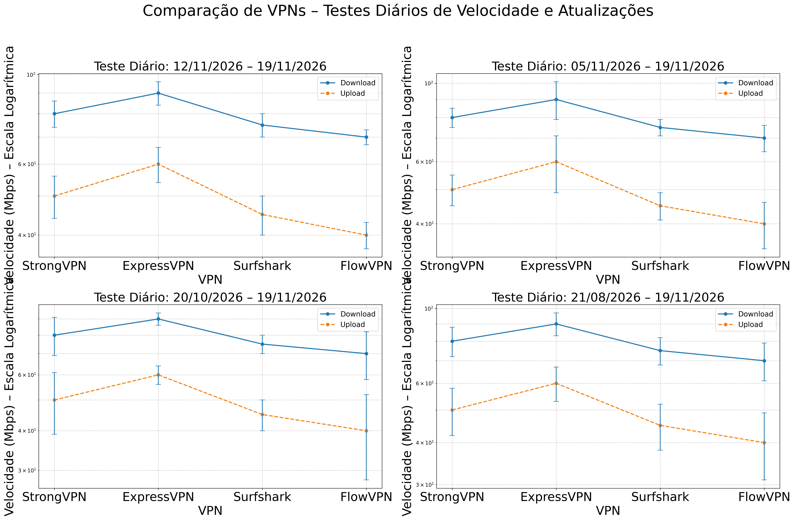

StrongVPN não precisa liderar cada barra para continuar em primeiro. Ela precisa atingir a velocidade necessária no serviço que motivou a compra e manter a vantagem de custo inicial. ExpressVPN é a alternativa premium, Surfshark atende muitos aparelhos e FlowVPN serve para uma verificação curta com renovação automática via PayPal.

## Escolha rápida

| Ordem | VPN | Faz sentido quando | Não faz sentido quando |
|---:|---|---|---|
| 1 | [StrongVPN](https://strongvpn.com/pt/?tr_aid=60d96b5810e50&chan=w_github_pt&data1=pt-home&data2=hero) | Você quer controlar o custo do primeiro ano e testar streaming, viagem ou Wi-Fi público | O app principal falha durante o reembolso ou o total do checkout muda |
| 2 | [ExpressVPN](https://go.expressvpn.com/c/3828265/1634695/16063) | Você aceita pagar mais por app polido, suporte e menor atrito | StrongVPN já resolve o mesmo uso e o premium não entrega diferença prática |
| 3 | [Surfshark](https://get.surfshark.net/aff_c?offer_id=323&aff_id=5585&source=w_github&aff_sub=pt) | Família ou casa precisa de conexões ilimitadas | Você usa só um ou dois aparelhos ou não quer um plano longo |
| 4 | [FlowVPN](https://www.flowvpx.com/sign-up/?locale=pt&special=FREETRIAL&r=35-890485.w_github) | Você consegue testar tudo em três dias e aceita criar uma autorização de pagamento no PayPal | Não conferiu o preço pós-teste, a renovação automática ou como cancelar no PayPal |

## Brasil primeiro; Portugal em uma rota separada

| Rota real | O que testar | Sinal para manter a VPN |
|---|---|---|
| Brasileiro no exterior | Globoplay, CazéTV, Premiere, app bancário, celular e TV | Login, direto, replay e 20 minutos de reprodução no aparelho principal |
| Pessoa em Portugal viajando | RTP Play, SIC, TVI, Sport TV e serviços portugueses | Servidor em Portugal, direitos da conta, app de TV e estabilidade |
| Brasil para conteúdo internacional | Netflix, Disney+, Prime Video e Max | Catálogo, legenda, conta e reprodução contínua |
| Casa com muitas telas | Celular, notebook, Fire TV, Apple TV e roteador | Todos os aparelhos necessários funcionam sem configuração constante |
| Hotel, aeroporto ou universidade | Portal de acesso, VPN depois, troca de rede e reconexão | A conexão volta de forma previsível antes de abrir e-mail, banco ou trabalho |

Uma VPN muda a rota e o IP. Ela não cria CPF, NIF, cartão local, residência nem direitos de conteúdo. Conta, pagamento, GPS, loja de aplicativos e regras da plataforma também precisam ser considerados.

## Preço em reais, euros e dólares

Referências de 19 de novembro de 2026: 1 USD ≈ R$5,73 ([PTAX do Banco Central do Brasil](https://ptax.bcb.gov.br/ptax_internet/consultarUltimaCotacaoDolar.do)) e 1 USD ≈ €0,91 ([taxa de referência do BCE](https://www.ecb.europa.eu/stats/policy_and_exchange_rates/euro_reference_exchange_rates/html/eurofxref-graph-usd.en.html)). Câmbio do cartão, IOF, IVA, impostos e campanha podem alterar o total; confirme o valor cobrado no checkout.

| VPN | Preço de referência | Leitura prática |
|---|---|---|
| [StrongVPN](https://strongvpn.com/pt/?tr_aid=60d96b5810e50&chan=w_github_pt&data1=pt-home&data2=price) | Página portuguesa do link: US$3,97/mês (≈R$22,75 / €3,61); US$47,69 (≈R$273 / €43,40) cobrados no primeiro ano antes de impostos | Menor desembolso inicial entre as ofertas verificadas; confirme total e renovação no checkout |
| [ExpressVPN](https://go.expressvpn.com/c/3828265/1634695/16063) | Basic: US$2,99/mês; US$83,72 nos primeiros 28 meses (≈R$480 / €76,19); depois US$99,95/ano (≈R$573 / €90,95), mais imposto quando aplicável | Prazo inicial mais longo; pague a diferença se app, suporte e 10 conexões justificarem o custo |
| [Surfshark](https://get.surfshark.net/aff_c?offer_id=323&aff_id=5585&source=w_github&aff_sub=pt) | Starter: US$2,49/mês; US$67,23 nos primeiros 27 meses (≈R$385 / €61,18), com IVA/imposto quando aplicável | Bom custo por aparelho se você usar conexões ilimitadas e aceitar o prazo longo |
| [FlowVPN](https://www.flowvpx.com/sign-up/?locale=pt&special=FREETRIAL&r=35-890485.w_github) | Teste de 3 dias após criar uma assinatura PayPal pré-aprovada; a cobrança começa automaticamente depois do teste | Só inicie quando puder testar e já souber o preço pós-teste e como cancelar no PayPal |

**Pagamento StrongVPN (17 de novembro de 2026):** use um cartão ou PayPal exibido no checkout do seu país. Não conclua a compra se moeda, imposto, primeiro débito, renovação ou método forem diferentes do esperado.

## Teste de compra em 30 minutos

1. Confira total, moeda, imposto, duração, renovação e reembolso no checkout.
2. Instale o app oficial no aparelho que você realmente usa.
3. Escolha a rota certa: servidor brasileiro, português ou internacional conforme o serviço.
4. Rode o aplicativo principal por 15 a 20 minutos, incluindo direto ou jogo se for importante.
5. Teste Wi-Fi e rede móvel quando viagem fizer parte do objetivo.
6. Mantenha StrongVPN apenas se passar; peça reembolso ou mude de categoria dentro do prazo.

## Conclusão

O mercado em português não precisa de uma tradução única. Brasil e Portugal exigem rotas, moedas e plataformas diferentes. O ponto em comum é o método: StrongVPN primeiro para testar um ano com custo controlado; ExpressVPN se app e suporte premium resolverem algo real; Surfshark para muitos aparelhos; FlowVPN para uma verificação curta.

Aviso: podemos receber comissão quando uma compra é feita pelos links. Isso não transforma o gráfico em garantia nem substitui o teste no seu aparelho e na sua rede.

<!-- NEWS_START -->
#### 19 de novembro de 2026: notícias de VPN, privacidade e cibersegurança
- **ExpressVPN já está disponível em aparelhos Amazon Vega OS compatíveis**: usuários de Fire TV, incluindo o Fire TV Stick 4K Select, podem instalar o app pela Amazon Appstore e controlar a conexão com o controle remoto. [Anúncio oficial](https://www.expressvpn.com/blog/expressvpn-amazon-vega-os/)
- **Vega OS pode enviar algumas consultas DNS fora do túnel VPN**: a ExpressVPN explica que esse é um comportamento do sistema operacional que afeta apps VPN em geral; o tráfego criptografado continua protegido, mas a limitação deve ser conhecida. [Nota oficial](https://www.expressvpn.com/support/troubleshooting/dns-queries-vega-os/)
- **Proton VPN lança em beta um novo núcleo de protocolos**: Proton Protocols pode ser testado no Windows, Android, iOS/iPadOS e Linux, com foco em estabilidade, resistência à censura e desenvolvimento multiplataforma. [Publicação oficial](https://protonvpn.com/blog/introducing-proton-protocols)
- **ExpressVPN publica relatório de transparência do primeiro semestre de 2026**: segundo a empresa, nenhum pedido revelou atividade VPN ou logs de conexão; entre 392 envios de segurança, 42 relatórios únicos foram classificados como válidos. [Relatório oficial](https://www.expressvpn.com/blog/transparency-report-h1-2026/)
- **Mullvad Android 2026.9-beta1 adiciona multihop condicional**: a beta traz mapa interativo, multihop automático quando as configurações exigem e busca melhorada; ainda não é uma versão estável geral. [Registro oficial](https://github.com/mullvad/mullvadvpn-app/blob/main/android/CHANGELOG.md)
<!-- NEWS_END -->

## Guias locais: Brasil e Portugal precisam de rotas diferentes

Globoplay precisa de uma rota brasileira; RTP Play, TVI Player e OPTO dependem de uma rota portuguesa e dos direitos de cada programa. Misturar tudo numa única recomendação cria expectativas erradas.

- **Brasil:** [Como testar VPN para Globoplay fora do Brasil sem confundir IP, conta e aparelho](./vpn-globoplay-brasil/)
- **Portugal:** [Como ver RTP Play, TVI Player e OPTO no estrangeiro: diagnóstico e teste de VPN](./vpn-tv-portuguesa-estrangeiro/)

Os dois guias mantêm a mesma ordem do site: StrongVPN, ExpressVPN, Surfshark, FlowVPN. A escolha final depende da plataforma, do país do servidor, do aparelho e do custo total no checkout.

## Navegação do Conteúdo

### 1. [Noções básicas de VPN](#basics-of-unrestricted-access)
### 2. [Principais Recursos das Melhores VPNs Globais – Resumo](#key-features-of-recommended-global-vpns)
#### 2.1 [StrongVPN – Melhor Custo-Benefício](#strongvpn-recommendation)
#### 2.2 [ExpressVPN – oferta oficial e preço no checkout](#expressvpn-12-months-+-3-months-free)
#### 2.3 [Surfshark – Conexões Ilimitadas em Dispositivos](#surfshark-unlimited-connections)
#### 2.4 [FlowVPN – Teste de 3 Dias](#flowvpn-2-day-free-trial)
#### 2.5 [Análise de Política de Privacidade & Comparação dos Principais Provedores de VPN](#privacy-policy-comparison-vpn-providers)
### 3. [StrongVPN – Guia Passo a Passo com Pagamentos Internacionais](#strongvpn-international-payment-tutorial)
#### 3.1 [Guia Passo a Passo: Configurando StrongVPN em Dispositivos Móveis (Android & iOS)](#tutorial-de-configuracion-de-strongvpn-en-androidios)
### 4. [Guia de Compra ExpressVPN – Pegue a Melhor Oferta](#expressvpn-purchase-tutorial)
#### 4.1 [Guia de Configuração ExpressVPN – PC, Celular & Tablet](#expressvpn-setup-tutorial)
### 5. [Surfshark – Guia Rápido de Compra (Oferta de Dispositivos Ilimitados)](#surfshark-purchase-tutorial)
### 6. [FlowVPN – Teste de 3 Dias & Guia de Compra](#flowvpn-purchase-and-free-trial-tutorial)
### 7. [VPNs a Evitar – Lista de Provedores Não Recomendados (Atualizada em 2026)](#vpn-avoid-list)
### 8. [Padrões de Recomendação de VPN & Recursos Essenciais](#vpn-recommendation-standards-and-essential-features)
### 9. [Conhecimento Essencial de VPN que Todo Mundo Deveria Entender](#essential-vpn-knowledge-you-need-to-know)
#### 9.1 [Double ou Multi-Hop VPNs – Como & Por Que Usar](#double-multi-hop-vpn-uses-benefits)
#### 9.2 [Como VPNs Afetam a Velocidade da Internet – Real Talk](#vpn-impact-on-network-speed)
#### 9.3 [Diferenças Entre "Software de Acesso" & VPNs Verdadeiras](#differences-between-access-software-and-vpns)
#### 9.4 [Por Que & Como Rotacionar/Trocar Provedores de VPN Regularmente pra Mais Segurança](#how-to-rotate-vpn-providers-for-better-security)
### 10. [O Que Você Pode Fazer com uma VPN + Precauções Importantes](#what-you-can-do-with-a-vpn-and-precautions)
### 11. [Introdução aos Protocolos Comuns de VPN & Ferramentas](#introduction-to-common-vpn-protocols)
#### 12.1 [Diferenças & Casos de Uso: VPN vs. Tor](#differences-and-use-cases-vpn-vs-tor)
#### 12.2 [VPN vs. Servidores Proxy – Diferenças Chave](#differences-between-vpn-and-proxy-servers)
### 12. [Análise de Servidores VPN – Dicas Práticas & Insights](#vpn-server-analysis-practical-tips)
#### 13.1 [Como Resolver Quedas e Interrupções de Conexão VPN](#how-to-fix-vpn-connection-drops)
#### 13.2 [Como Manter Sua VPN Sempre Ligada & Confiável](#how-to-keep-vpn-always-active)
### 13. [Por Que Não Recomendamos VPNs Grátis – Os Riscos Reais](#risks-of-free-vpns-why-we-dont-recommend-them)
### 14. [Por Que Não Recomendamos Criar Sua Própria VPN](#why-not-build-your-own-vpn)
### 15. [Melhores Recursos de VPN pra Games – Suba de Nível no Seu Jogo](#vpn-features-for-gaming)
### 16. [Guia Passo a Passo: Assistir Conteúdo Global de Streaming com uma VPN](#guide-to-streaming-with-vpn)
#### 17.1 [Como Netflix & Hulu Detectam & Bloqueiam Conexões VPN](#how-netflix-and-hulu-detect-and-block-vpns)
### 17. [Relatório Detalhado de Testes de Velocidade VPN (Atualização Diária Fresca – 19 de novembro de 2026)](#detailed-vpn-speed-test-report)
#### 18.1 [Taxas de Sucesso de Conexão por Continente](#vpn-connection-success-rates-by-continent)
#### 18.2 [Testes de Velocidade VPN em Regiões Globais](#vpn-speed-tests-global-regions)
#### 18.3 [Taxas de Sucesso de Conexão Netflix por Continente](#netflix-connection-success-rates-by-continent)
#### 18.4 [Taxas de Sucesso de Conexão Disney+ por Continente](#disney-plus-connection-success-rates-by-continent)
### 18. [Tutorial de Instalação de VPN no Linux](#vpn-installation-tutorial-on-linux)
### 19. [Apps & Serviços que Podem Bloquear ou Restringir VPNs](#apps-and-services-that-may-block-vpns)
### 20. [BitTorrent com VPN – Setup & Melhores Práticas](#bittorrent-with-vpn-setup-tips)
### 21. [FlowVPN pra Apple TV – Por Que Se Destaca](#vpn-for-apple-tv)
#### 23.1 [Limitações Comuns de VPN & Como Resolver](#vpn-limitations-and-solutions)
**Última atualização:** 19 de novembro de 2026

>Este guia foca no uso real de VPN para streaming, viagens, trabalho remoto, Wi-Fi público e privacidade. Muitos sites apenas copiam listas de marcas, mas não explicam se a VPN serve para assistir a um app específico, proteger uma conexão em hotel ou manter velocidade estável em videochamadas. Aqui reunimos testes de velocidade, tutoriais e critérios práticos para escolher com menos risco.

VPN não é magia. Ela só faz sentido quando resolve um problema concreto: assistir conteúdo durante uma viagem, reduzir risco em redes abertas, proteger dados de trabalho, evitar rastreamento simples por IP ou testar catálogos de streaming de outros países. Por isso comparamos preço, estabilidade, facilidade de uso, suporte, servidores e garantia de reembolso.

>O mercado muda rápido. Um servidor que funciona hoje pode falhar amanhã, e uma VPN barata pode sair cara se limitar dados, registrar atividade ou não responder no suporte. Esta página combina atualizações, gráficos de velocidade e links de compra para que você teste cada serviço dentro do prazo de garantia.

Em vez de recomendar uma única marca para todo mundo, pense por cenário: ExpressVPN para experiência premium e estabilidade; StrongVPN para custo anual equilibrado; Surfshark para família e muitos aparelhos; FlowVPN para quem quer testar antes de assumir um plano longo.

## Notícias Recentes sobre VPN
A atualização de segurança da Microsoft em junho de 2024 causou problemas de conexão VPN para muitos usuários do Windows 11, 10 e Server 2008+. Vários relatos no Reddit mencionaram falhas após o patch, muitas vezes resolvidas temporariamente reinstalando o app da VPN. A Microsoft reconheceu o problema e prometeu correção futura.  
<!-- [Artigo original completo](https://tw.news.yahoo.com/microsofts-latest-windows-security-updates-might-break-your-vpn-001216447.html) -->

## Estado Atual do Mercado de VPNs
O mercado de VPN muda em ciclos: novas ofertas, reajustes de preço, servidores saturados, bloqueios de streaming e melhorias nos aplicativos. Por isso não avaliamos apenas uma captura de velocidade. Uma boa VPN precisa combinar estabilidade, suporte, variedade de servidores, apps claras e política de reembolso fácil de entender.

Serviços fracos costumam falhar pelos mesmos motivos: pouca estrutura de servidores, apps sem manutenção, suporte lento ou promessa exagerada de desbloqueio. Quando uma VPN piora, você percebe em quedas, vídeos que não carregam, velocidade ruim em horário de pico ou falta de resposta do suporte.

Nos nossos testes, **ExpressVPN** continua forte para quem paga por simplicidade e estabilidade. **StrongVPN** faz sentido para custo-benefício anual. **Surfshark** se destaca quando há muitos aparelhos. **FlowVPN** fica como opção para testar compatibilidade antes de compromisso longo.

Este site inclui guias detalhados, testes de velocidade e soluções para problemas comuns. Use a navegação para pular direto para a seção que você precisa.

### 1. [Noções básicas de VPN](#basics-of-unrestricted-access)

### O que é uma VPN e para que serve?

Uma VPN cria um túnel criptografado entre seu aparelho e um servidor remoto. Com isso, ela muda o IP visível, protege parte do tráfego em redes inseguras e permite escolher outra localização de servidor. Na prática, a maioria usa VPN para três coisas: streaming em viagens, segurança no Wi-Fi público e privacidade básica no trabalho remoto.

#### Restrições regionais e streaming

Netflix, Disney+, Prime Video, Max, Globoplay, DAZN e outros apps podem mostrar catálogos diferentes por país. Alguns também bloqueiam IPs conhecidos de VPN por causa de contratos de licença. Por isso, o ideal é escolher um provedor com vários servidores, suporte rápido e garantia de reembolso clara.

#### Por que usar VPN em viagens?

Em viagens, é comum usar Wi-Fi de hotel, aeroporto, universidade, shopping ou café. Essas redes são convenientes, mas você não controla quem está conectado ou como a rede foi configurada. Uma VPN adiciona uma camada de criptografia ao acessar e-mail, banco, contas de trabalho e serviços pessoais.

#### Segurança e legalidade

Na maioria dos países, usar VPN para privacidade, trabalho remoto e segurança é legal. Mesmo assim, respeite leis locais e os termos de uso de cada serviço. VPN não transforma atividade ilegal em legal e também não substitui senha forte, autenticação de dois fatores e bom senso.

#### Wi-Fi público: cafés, aeroportos e hotéis

Wi-Fi público é prático, mas pode ser arriscado. Em redes compartilhadas, uma VPN ajuda a proteger sessões, mensagens, e-mails e dados sensíveis. Para quem viaja ou trabalha fora de casa, é uma das razões mais simples para instalar VPN antes de precisar.

## Principais Recursos das Melhores VPNs Globais – Resumo

Esta comparação combina os gráficos recorrentes do projeto, condições públicas dos provedores e um roteiro de teste no aparelho do leitor. O gráfico não prova que uma VPN abrirá cada plataforma; ele serve para comparar tendência de velocidade enquanto preço, prazo, pagamento e funcionamento local são verificados separadamente.

- Segurança de alto nível (provedores fora de regiões restritas, preferencialmente em jurisdições no-logs)
- Estabilidade de conexão sólida
- Velocidade máxima possível
- Rede enorme de servidores (acesso a muitos países/regiões)
- Super fácil de usar (conexão com um clique)
- Criptografia avançada e recursos de privacidade
- Suporte a múltiplos dispositivos simultâneos
- Compatibilidade ampla (Windows, macOS, Linux, Android, iOS, roteadores etc.)
- Suporte ao cliente 24/7 em vários idiomas
- Garantia de devolução de 30 dias
- Opções de pagamento flexíveis (incluindo métodos internacionais)
- Preço justo com excelente custo-benefício

### 1. [StrongVPN – Melhor Custo-Benefício](https://strongvpn.com/pt/?tr_aid=60d96b5810e50&chan=w_github_pt&data1=pt-body&data2=title)
Antes de escolher uma VPN, não olhe só o preço mensal. Para streaming, viagens e trabalho remoto, uma boa VPN precisa entregar um conjunto prático de recursos:

- Apps claras para Windows, macOS, iPhone, Android e, se possível, TV ou roteador.
- Velocidade suficiente para vídeo HD/4K, chamadas de vídeo e downloads normais.
- Vários servidores em países úteis para streaming e viagens.
- Troca rápida de servidor quando um app mostra erro regional.
- Política de privacidade clara e sem registro de atividade de navegação.
- Kill switch e proteção contra vazamento de DNS/IP.
- Suporte que responde quando um servidor falha.
- Garantia de reembolso para testar seus apps reais antes de decidir.
- Bom equilíbrio entre preço anual, renovação e número de aparelhos.

Com esses critérios, as quatro opções principais desta página atendem perfis diferentes: StrongVPN para custo equilibrado, ExpressVPN para experiência premium, Surfshark para muitos aparelhos e FlowVPN para testes curtos.

Em uma conexão residencial, a diferença relevante é se a VPN mantém velocidade suficiente no servidor, horário e aplicativo usados de verdade. Use o gráfico como referência relativa e confirme o resultado durante o prazo de reembolso.

**12 Conexões Simultâneas**: Rode a StrongVPN em até 12 dispositivos ao mesmo tempo — ótimo pra família ou múltiplos gadgets.

### Recursos Principais da StrongVPN

- Suporte amplo de plataformas: Apps pra iOS, Android, macOS, Windows, além de guias pra Linux & roteadores
- Até 12 conexões simultâneas
- Compatibilidade com streaming precisa ser testada em cada serviço, país e aparelho
- Inclui 250 GB de armazenamento cloud SugarSync (bônus no plano anual)
- 950+ servidores pelo mundo
- Protocolos: WireGuard, OpenVPN, IKEv2, L2TP/IPsec, SSTP
- Garantia de devolução de 30 dias
- Suporte 24/7 via chat ao vivo & e-mail
- Política do provedor declara não registrar atividade de navegação; leia a versão atual antes da compra
- Total inicial da página portuguesa é menor que o primeiro período atual da ExpressVPN
- Aceita pagamentos internacionais (cartões de crédito, PayPal etc.)
- Estabilidade varia por rota, operadora e protocolo e deve ser testada no uso principal

| Recurso / Especificação          | StrongVPN                          |
|----------------------------------|------------------------------------|
| Plataformas de Cliente           | Windows, macOS, Linux, Android, iOS, DD-WRT, GL.iNet roteadores, Android TV |
| Protocolos Suportados            | OpenVPN, L2TP/IPsec, SSTP, WireGuard |
| Número de Servidores             | 950+                               |
| Número de Países                 | 35+                                |
| Jurisdição / Sede                | Estados Unidos                     |
| Métodos de Pagamento             | Cartões de crédito, PayPal, opções internacionais |
| ID / Verificação Necessária?     | Pode variar conforme pagamento e análise antifraude |
| Protocolos de Criptografia       | WireGuard, OpenVPN, IKEv2, L2TP, SSTP |
| Limite de Dados / Banda          | Ilimitado                          |
| Limites de Uso                   | Ilimitado                          |
| Dispositivos Conectados Simultâneos | 12                              |
| Suporte ao Cliente               | E-mail, chat ao vivo 24/7, telefone |
| Política de Privacidade          | Provedor declara política no-logs; verificar texto atual |

### 2. [ExpressVPN – oferta oficial e preço no checkout](https://go.expressvpn.com/c/3828265/1634695/16063)

ExpressVPN é a alternativa premium desta página para quem aceita um custo inicial maior em troca de apps maduros, suporte e ampla cobertura de plataformas. Isso não garante que um serviço de streaming específico funcione em toda rede ou horário.

Oferece apps para Windows, macOS, Android, iOS, Linux e plataformas de TV, além de configuração para roteadores. Lightway, criptografia e Network Lock fazem parte do conjunto de segurança; disponibilidade e comportamento de recursos podem variar por sistema.

A ExpressVPN informa **214 localizações em 113 países**. A rede ampla oferece rotas alternativas, mas o número de localizações não garante que todo serviço de streaming funcione. Teste o país, o aparelho e a plataforma que você realmente usa durante o prazo de reembolso.

O principal ponto de atenção é o contrato inicial longo. Só vale pagar a diferença quando app, suporte ou compatibilidade resolverem algo que a opção mais barata não resolveu.

#### Recursos Principais da ExpressVPN

- Rede anunciada em 113 países
- Basic permite 10 conexões simultâneas
- Protocolo Lightway e seleção automática de localização
- Garantia de devolução de 30 dias
- **Suporte 24/7 via chat ao vivo** (gente de verdade, não bots)
- Apps nativos pra Windows, macOS, iOS, Android, Linux, além de roteadores, consoles, smart TVs e mais
- Métodos de pagamento e moedas variam; confira o checkout regional
- Criptografia líder da indústria (AES-256-GCM, protocolo Lightway)

**Oferta e preço verificados em 17 de novembro de 2026**: o Basic mostra US$2,99/mês, cobrança de US$83,72 pelos primeiros 28 meses e renovação de US$99,95/ano, com imposto quando aplicável. A garantia de 30 dias é apresentada para novos usuários; leia os termos e solicite o reembolso dentro do prazo se o serviço não atender.

| Recurso                        | ExpressVPN                                      |
|--------------------------------|-------------------------------------------------|
| Número de Servidores           | A empresa destaca cobertura e capacidade, não um total fixo nesta oferta |
| Número de Países               | 113                                             |
| Plataformas Suportadas         | Windows, macOS, iOS, Android, Linux, roteadores e plataformas de TV compatíveis |
| Conexões Simultâneas           | 10 no Basic                                     |
| Split Tunneling                | Sim                                             |
| Kill Switch                    | Sim (network lock)                              |
| Protocolos Suportados          | Lightway, OpenVPN e opções que variam por plataforma |
| Jurisdição / Sede              | Ilhas Virgens Britânicas                         |
| Suporte ao Cliente             | Chat ao vivo 24/7, e-mail, base de conhecimento extensa |

### 3. [Surfshark – Conexões Ilimitadas em Dispositivos](https://get.surfshark.net/aff_c?offer_id=323&aff_id=5585&source=w_github&aff_sub=pt)

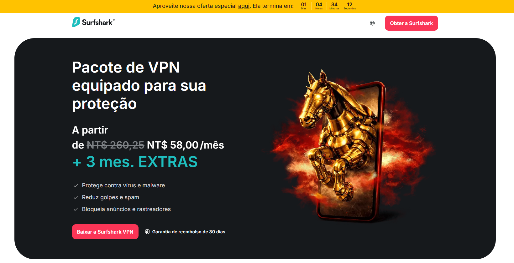

**Surfshark** é a opção para casas com muitos aparelhos: uma assinatura permite conexões simultâneas ilimitadas. O menor preço anunciado depende de um pagamento inicial longo, por isso o total e o prazo importam mais que a manchete mensal.

O site oficial informa **4.500+ servidores em 100 países**. Há apps para Windows, macOS, iOS, Android e Linux, extensões de navegador e recursos para dispositivos compatíveis; confirme o método necessário para sua TV ou console.

Segurança top com criptografia AES-256-GCM, suporte a WireGuard (super rápido), OpenVPN e IKEv2, política no-logs estrita (auditada independentemente), e kill switch pra proteger se a conexão cair. A Surfshark está sediada nos Países Baixos; o Trust Center publica avaliações externas da política no-logs. Consulte a política atual para dados de conta, cobrança e conexão temporária.

Para streaming, teste Globoplay, Netflix, Disney+, Prime Video ou a plataforma relevante no aparelho principal. Um catálogo que funciona hoje pode mudar quando a plataforma bloqueia um endereço IP.

#### Recursos Principais da Surfshark

- Preço mensal anunciado baixo, condicionado ao pagamento inicial longo
- Auditorias de segurança independentes recentes pra mais tranquilidade
- Compatibilidade de streaming deve ser confirmada no serviço usado
- Pagamentos flexíveis: cartões de crédito, PayPal, cripto, Amazon Pay, Google Pay
- Suporte ao cliente 24/7 prestativo
- Mais de 4.500 servidores em 100 países e conexões simultâneas ilimitadas
- **Dispositivos ilimitados** — cubra toda a casa (celulares, notebooks, TVs etc.)
- Garantia de devolução de 30 dias
- Starter mostra US$2,49/mês e US$67,23 nos primeiros 27 meses (≈R$385 / €61,18), com IVA/imposto quando aplicável; confira a renovação no checkout
- Surfshark Nexus (recursos avançados como IP Rotator pra trocar IP automaticamente a cada poucos minutos sem desconectar, e mais ferramentas adicionadas com o tempo)

### 4. [FlowVPN – Teste de 3 Dias](https://www.flowvpx.com/sign-up/?locale=pt&special=FREETRIAL&r=35-890485.w_github)

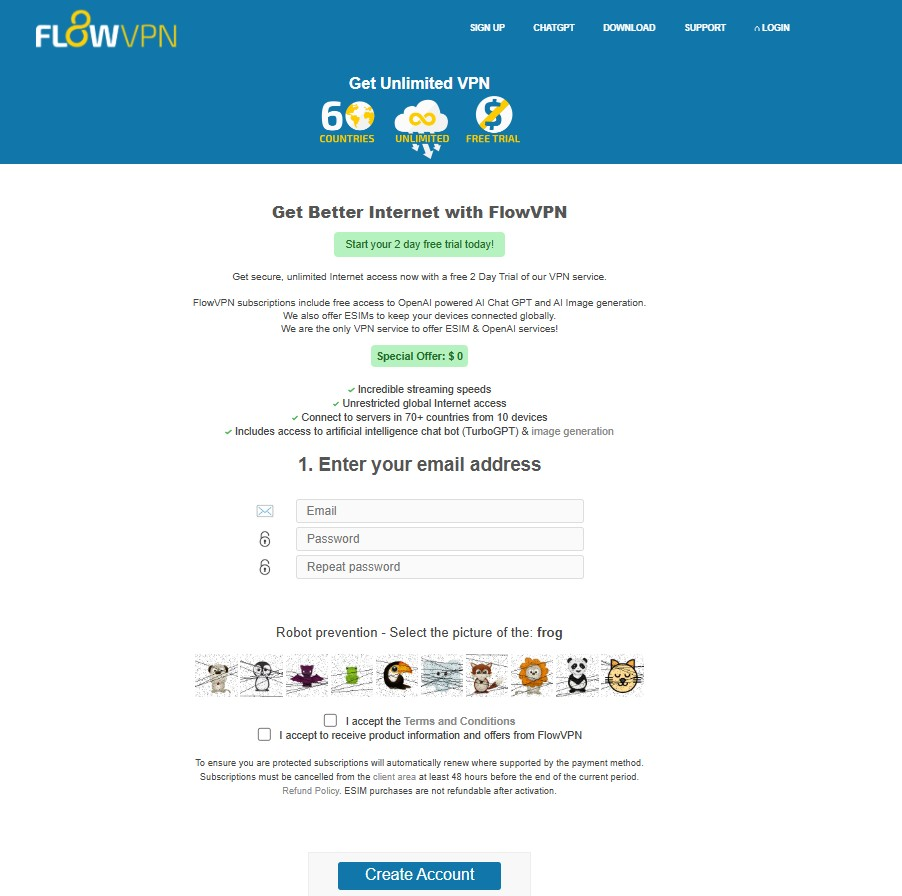

**FlowVPN** oferece **teste de 3 dias**, mas o cadastro exige criar uma assinatura PayPal pré-aprovada. A cobrança começa automaticamente depois do teste, portanto só inicie quando puder testar imediatamente e souber cancelar pelo PayPal se não quiser continuar.

Use o período para verificar velocidade, estabilidade, Windows e a plataforma de streaming necessária. O gráfico mostra os resultados do projeto, não uma promessa para toda conexão.

#### Recursos Principais da FlowVPN

- **Teste de 3 dias** — exige autorização PayPal e converte automaticamente em assinatura paga
- Planos longos acessíveis, ótimos pra estudantes e uso diário
- Compare a velocidade no seu servidor e horário (consulte também o gráfico recorrente)
- Pagamento do teste e da assinatura por PayPal na página verificada
- Ampla gama de protocolos: IPSec IKEv1/IKEv2, WireGuard, OpenVPN, L2TP, PPTP, além de SSL custom e FlowTCP
- Mais de 100 servidores em 60+ países (cobertura forte no Reino Unido, EUA, Austrália e mais)
- Apps nativos pra Windows, macOS, iOS, iPad, Android
- Até **4 conexões simultâneas em dispositivos**
- Preço pós-teste e cancelamento devem ser conferidos antes de autorizar o PayPal

### Resumo de privacidade antes da compra

Ao escolher uma VPN, a **política de privacidade** é um dos fatores mais críticos pra proteger seus dados e identidade real. Aqui vai uma comparação clara e lado a lado entre ExpressVPN, StrongVPN e Surfshark — os três mais recomendados neste guia.

#### ExpressVPN
Sediada nas Ilhas Virgens Britânicas, a ExpressVPN publica política no-logs, auditorias independentes e relatórios de transparência. Essas fontes ajudam a avaliar a implementação, mas não eliminam a necessidade de ler a política atual.
<!---->
#### StrongVPN
A StrongVPN está sediada nos Estados Unidos e declara não registrar atividade ou tráfego VPN. Como a empresa não apresenta o mesmo volume de auditorias públicas das alternativas acima, trate a política do provedor e a jurisdição como parte da decisão.

#### Surfshark
A Surfshark está sediada nos Países Baixos. Seu Trust Center informa avaliações Deloitte dos compromissos no-logs em 2023 e 2025. Isso oferece evidência externa, mas não substitui a leitura da política vigente.

| Recurso                          | ExpressVPN                     | StrongVPN                  | Surfshark                      |
|----------------------------------|--------------------------------|----------------------------|--------------------------------|
| Jurisdição                       | Ilhas Virgens Britânicas       | Estados Unidos             | Países Baixos                  |
| Evidência publicada sobre logs   | Política, auditorias e transparência | Política do provedor | Política, auditorias e transparência |
| O que conferir                   | Relatórios e política atuais | Política e evidência externa disponível | Trust Center e política atuais |

**Resumo final**: ExpressVPN e Surfshark publicam mais evidência externa; StrongVPN fica na frente desta página pelo custo inicial, não por ter a comprovação de privacidade mais ampla. Confira a política e os relatórios atuais antes de decidir.

## Tutoriais Passo a Passo: Comprando StrongVPN com Pagamentos Internacionais & Configurando ExpressVPN

## StrongVPN – Guia Passo a Passo com Pagamentos Internacionais

**Verificação de pagamento:** use um cartão ou PayPal oferecido no checkout local. Confira moeda, imposto, primeiro débito, endereço de cobrança e renovação antes de confirmar.

### Passo 1: Acesse Nossa Oferta Exclusiva
Clique no nosso link especial pra pegar o melhor desconto: [StrongVPN](https://strongvpn.com/pt/?tr_aid=60d96b5810e50&chan=w_github_pt&data1=pt-body&data2=title) → Clique em "Start Now" (veja a captura de tela abaixo).  

### Passo 2: Confira acesso, preço e renovação
Se o site não carregar, desligue outra VPN ou proxy, tente sua conexão residencial ou móvel e abra o link novamente. Não compre uma segunda VPN apenas para chegar ao checkout.
A página portuguesa mostra US$3,97 por mês (≈R$22,75 / €3,61) e US$47,69 (≈R$273 / €43,40) no primeiro ano, antes de impostos. O total, a moeda e a renovação exibidos no checkout são a referência final. 
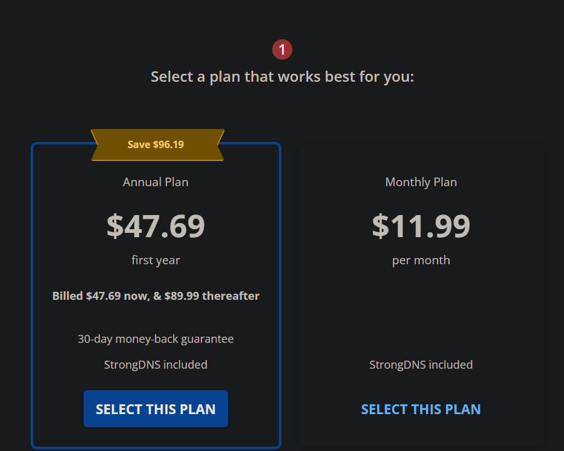

### Passo 3: Escolha Seu Método de Pagamento
Role até a seção de pagamento e escolha um cartão disponível ou PayPal. Confira titular, endereço de cobrança, moeda, primeiro débito e renovação antes de pagar.

### Guia Passo a Passo: Configurando StrongVPN em Dispositivos Móveis (Android & iOS)

Seja no Android ou iOS, colocar a StrongVPN pra rodar no celular é super simples — só alguns toques e você já está protegido em qualquer lugar.

#### 1. Comprar & Criar Sua Conta StrongVPN
Acesse nosso link exclusivo: [StrongVPN](https://strongvpn.com/pt/?tr_aid=60d96b5810e50&chan=w_github_pt&data1=pt-body&data2=title), escolha seu plano (1 ano pro melhor custo-benefício) e cadastre-se.

#### 2. Instalar & Conectar no Android
- Abra a Google Play Store e busque por "StrongVPN".
- Toque em "Instalar" pra baixar o app oficial.
- Abra o app, digite seu usuário e senha, depois toque em "Log In".
- Toque em "Best Available Location" pra conexão automática mais rápida, ou escolha um país/servidor manualmente.

#### 3. Instalar & Conectar no iOS (iPhone/iPad)
- Abra a App Store e busque por "StrongVPN".
- Toque em "Obter" pra baixar e instalar.
- Abra o app, faça login com suas credenciais.
- Selecione "Best Available Location" pra conexão ótima automática, ou escolha um servidor da lista.

Depois de conectar, confirme o endereço IP, ative o kill switch se disponível e teste o aplicativo que motivou a compra. Streaming e estabilidade podem variar por servidor.

## Guia de Compra ExpressVPN – Pegue a Melhor Oferta

**Nota**: métodos de pagamento, moeda e imposto podem variar por região. Use o link da oferta, mas só conclua depois de conferir o total e a renovação no checkout.

### Passo 1: Abra a oferta da ExpressVPN
Clique aqui: [Oferta ExpressVPN](https://go.expressvpn.com/c/3828265/1634695/16063) → Toque em "Get ExpressVPN" (procure o botão destacado na captura).  
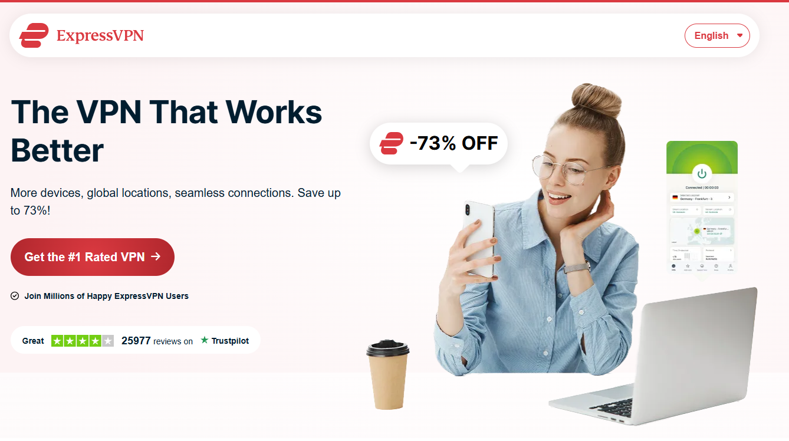

| Duração da Assinatura           | Custo Total | Equivalente Mensal          |
|---------------------------------|-------------|-----------------------------|
| Basic - primeiros 28 meses      | US$83,72   | US$2,99 na manchete mensal  |
| Renovação Basic                 | US$99,95/ano | Aproximadamente US$8,33/mês |
| Outras durações e planos        | Ver checkout | Preço varia por país, moeda, imposto e plano escolhido |

### Passo 2: Confira a oferta oficial atual
A página oficial pode mostrar planos e campanhas diferentes. Antes de pagar, confira preço total, moeda, impostos, renovação e termos de reembolso no checkout.  
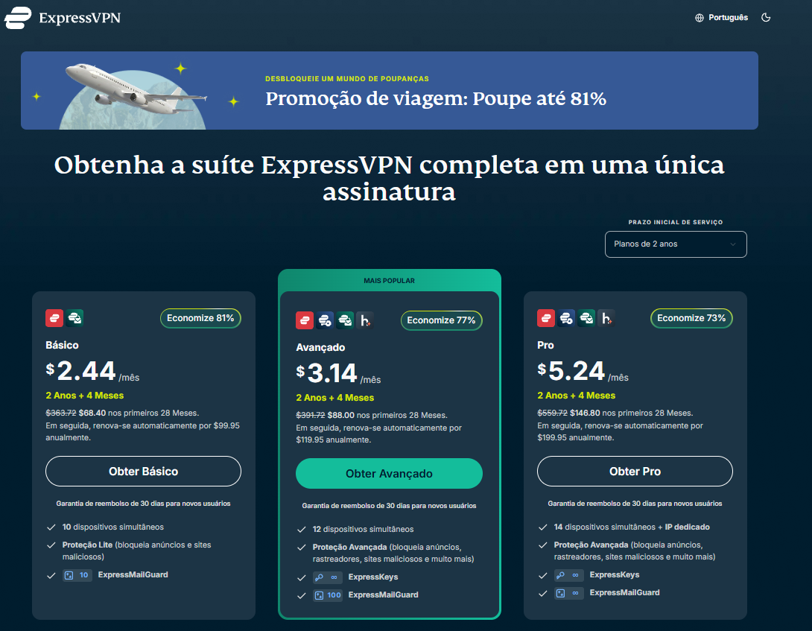

### Passo 3: Digite E-mail & Detalhes de Pagamento
Use um e-mail válido (vai precisar pra login + verificação). Escolha seu método de pagamento — cartões, PayPal, Bitcoin funcionam ótimo. Confira tudo duas vezes pra evitar problemas de verificação.  
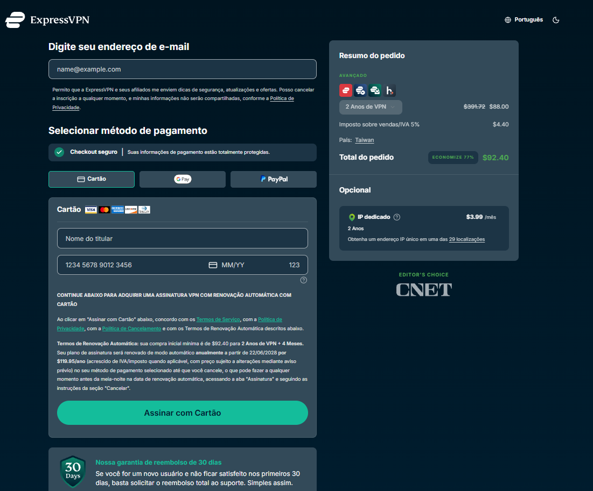

## Guia de Configuração ExpressVPN – PC, Celular & Tablet

Depois de ter sua conta, a configuração leva menos de 5 minutos em qualquer dispositivo. Veja como se proteger rapidinho.

#### 1. Comprar & Cadastrar na ExpressVPN
Use nosso link: [ExpressVPN](https://go.expressvpn.com/c/3828265/1634695/16063), confira os planos atuais, veja o preço total no checkout e crie sua conta.

#### 2. Instalar & Conectar no PC (Windows/macOS)
- Faça login no site da ExpressVPN, baixe o app pro seu sistema.
- Execute o instalador e siga as instruções rápidas.
- Abra o app, faça login e conecte com "Smart Location" (escolhe automaticamente o mais rápido) ou escolha qualquer servidor manualmente.

#### 3. Instalar & Conectar no Celular (Android/iOS)
- No celular, acesse o site da ExpressVPN (ou busque na loja de apps), baixe o app oficial.
- Abra, faça login com suas credenciais.
- Toque em "Smart Location" pra conexão instantânea ótima, ou escolha um país/servidor da lista completa.

#### 4. Instalar & Conectar no Tablet (iPad/Tablet Android)
- Igual ao celular: Acesse o site do tablet, baixe o app (ou pegue na loja).
- Faça login, conecte via "Smart Location" ou seleção manual.

Depois da instalação, teste vazamento de IP/DNS, kill switch, velocidade e o serviço principal. Nenhum app garante privacidade total ou acesso permanente a todo catálogo.

As principais opções, ofertas e etapas de configuração estão cobertas. Antes de pagar, confira preço total, garantia de reembolso e se seus apps principais funcionam durante o teste.

## Guia Passo a Passo: Comprando Surfshark & FlowVPN

## Surfshark – Guia Rápido de Compra (Oferta de Dispositivos Ilimitados)

### Passo 1: Abra a oferta longa da Surfshark
Clique no nosso link de afiliado especial: [Surfshark – Conexões Ilimitadas](https://get.surfshark.net/aff_c?offer_id=323&aff_id=5585&source=w_github&aff_sub=pt) → Toque em "Get Surfshark" (veja o botão na captura de tela abaixo).  

### Passo 2: Confira o total do plano longo
O Starter mostra US$2,49/mês e US$67,23 nos primeiros 27 meses (≈R$385 / €61,18), com IVA/imposto quando aplicável. O preço de renovação pode ser diferente; confira o valor final antes de pagar. 
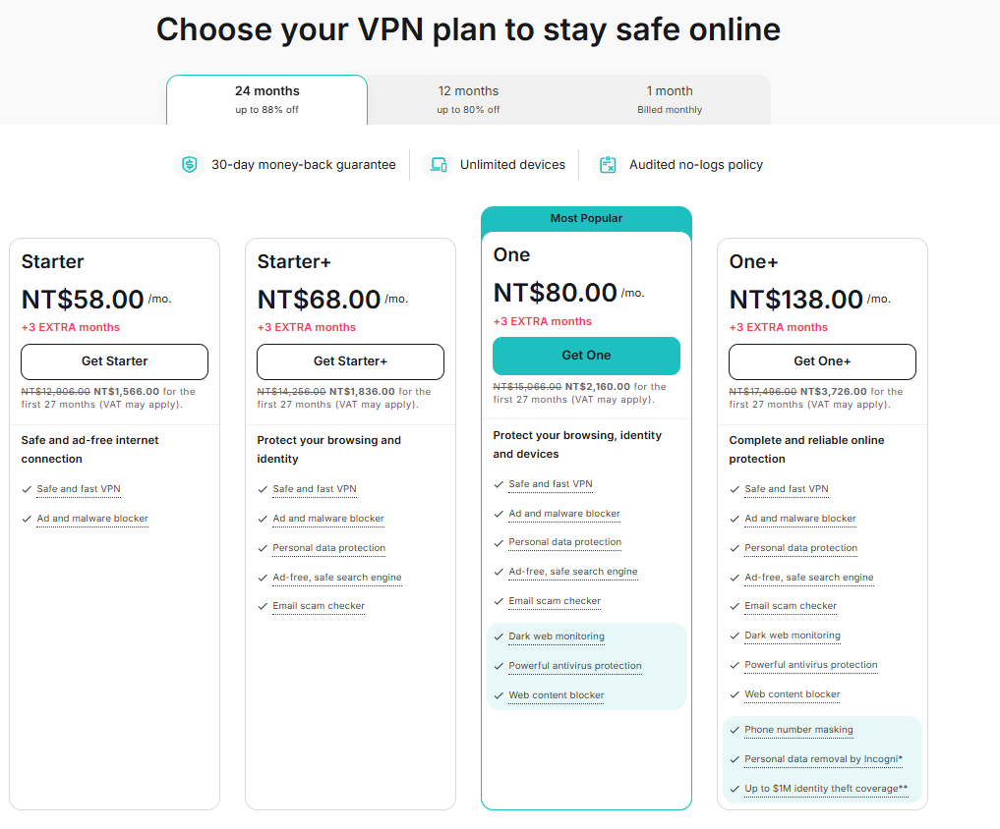

### Passo 3: Digite E-mail & Finalize o Pagamento
Use um e-mail válido (vai receber login + código de verificação). Escolha seu método de pagamento — eles aceitam Visa/MasterCard internacionais, PayPal, Bitcoin, Google Pay, Amazon Pay e mais. Confira tudo duas vezes pra evitar qualquer problema!  
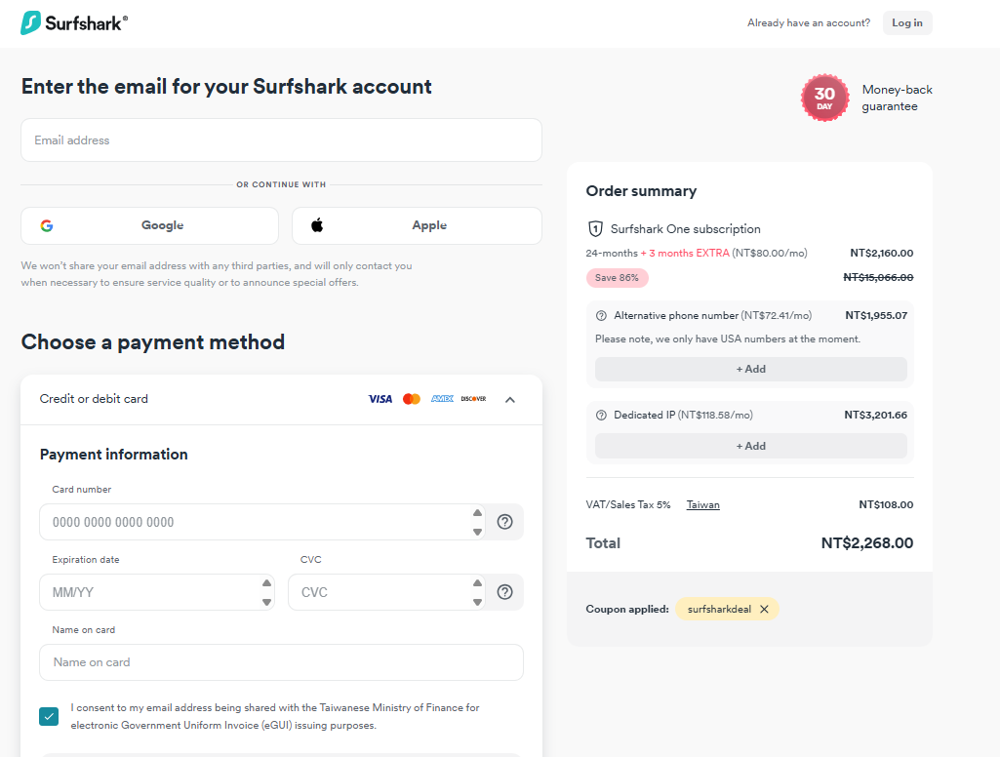

Depois da instalação, conecte os aparelhos necessários e teste velocidade, kill switch e streaming antes do fim do prazo de reembolso.

## FlowVPN – Teste de 3 Dias & Guia de Compra

FlowVPN oferece um **teste curto de 3 dias**, ativado depois da criação de uma assinatura PayPal pré-aprovada. Se você não cancelar, a cobrança recorrente começa após o teste.

### Passo 1: Inicie o Teste Grátis
Acesse nosso link especial: [FlowVPN – Teste de 3 Dias](https://www.flowvpx.com/sign-up/?locale=pt&special=FREETRIAL&r=35-890485.w_github)  
Digite seu e-mail e crie uma senha (confira se está correta!).  
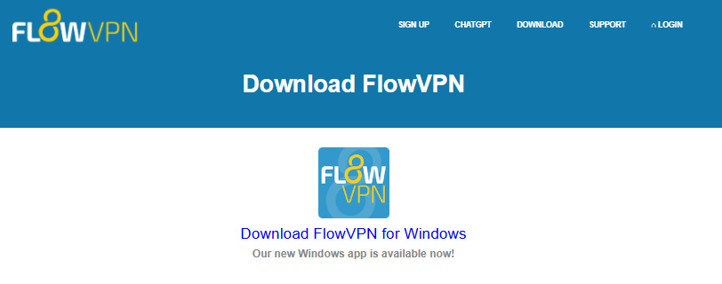

### Passo 2: Autorize o PayPal e conclua a verificação
Leia o preço pós-teste e a recorrência, conclua a verificação apresentada e só autorize o PayPal se os termos estiverem claros.
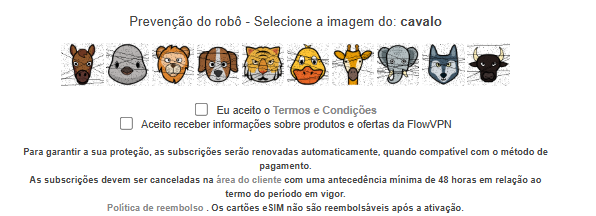

### Passo 3: Baixe & Comece a Usar
Depois de registrado, vá pra página oficial de download: https://www.flowvpx.com/download/  
Escolha o app pro seu dispositivo (Windows, macOS, Android, iOS). Instale, faça login com as credenciais do teste e conecte instantaneamente!  
(Se continuar, a assinatura PayPal passa a cobrar conforme o plano autorizado. O cancelamento deve ser feito antes do fim do teste para evitar a primeira cobrança.)

### Bônus: Resumo dos Recursos Principais da FlowVPN (Por Que É Ótima pra Testar)

- **Teste de 3 dias** — exige assinatura PayPal pré-aprovada e renovação automática
- Planos pagos super acessíveis, ideais pra estudantes/usuários leves
- Velocidades e estabilidade competitivas (confira os resultados reais de teste abaixo)
- Pagamento e cancelamento administrados pelo PayPal na oferta verificada
- Protocolos amplos: IPSec IKEv1/IKEv2, WireGuard, OpenVPN, L2TP, PPTP, além de SSL custom & FlowTCP
- Mais de 100 servidores em 60+ países (forte no Reino Unido, EUA, Austrália etc.)
- Apps pra Windows, macOS, iOS, iPad, Android
- Até 4 dispositivos simultâneos
- Descontos especiais pra estudantes e educadores

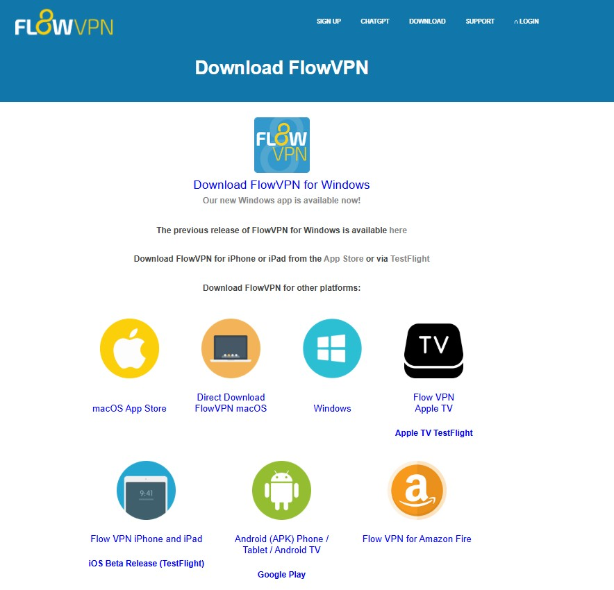

## Problemas de Conexão VPN em Períodos Sensíveis & Dicas Profissionais

Em períodos de alta restrição ou "sensíveis" (ex.: eventos políticos, grandes atualizações ou bloqueios regionais), algumas VPNs podem ter bloqueios temporários ou lentidão. Veja como ficar sempre conectado:

- **Melhores Backups**: FlowVPN (com protocolos custom como FlowTCP & SSL) costuma funcionar quando as outras travam — use o teste grátis pra testar nesses momentos.
- **StrongVPN & Surfshark** geralmente se recuperam mais rápido com atualizações frequentes de servidores.
- **ExpressVPN** tem a maior taxa de sucesso no geral graças aos recursos massivos e updates rápidos.
- **Dicas de Mestre**:
  - Troque de protocolo (WireGuard primeiro, depois IKEv2/OpenVPN).
  - Experimente servidores diferentes (EUA/Reino Unido/Hong Kong costumam ficar abertos por mais tempo).
  - Ative modos de ofuscação/camuflagem se disponível.
  - Tenha 2–3 VPNs prontas (ex.: Surfshark pro dia a dia, FlowVPN como backup de emergência).
  - Baixe apps & configs **antes** de qualquer restrição apertar.

Teste o provedor com os serviços que você realmente usa e avalie velocidade real, qualidade do app e suporte.

### Evidências de privacidade e limitações

Política de privacidade, jurisdição, auditorias e relatórios de transparência são sinais diferentes. A tabela abaixo compara a evidência que cada provedor publica; nenhuma política substitui a avaliação do seu próprio modelo de risco.

#### ExpressVPN
Sediada nas **Ilhas Virgens Britânicas**, a ExpressVPN publica política no-logs, auditorias de terceiros e relatórios de transparência. Consulte os documentos atuais para saber o escopo e o período coberto por cada auditoria.

#### StrongVPN
Sediada nos **Estados Unidos**, a StrongVPN declara não registrar atividade ou tráfego VPN. A quantidade de evidência externa pública é menor que nas duas alternativas, portanto a recomendação em primeiro lugar nesta página vem do custo inicial e do teste prático, não de uma alegação de privacidade superior.

#### Surfshark
Sediada nos **Países Baixos**, onde a Surfshark afirma que o GDPR da UE se aplica.
Surfshark publica política no-logs, avaliações externas e informações no Trust Center. Leia o escopo dos relatórios e a política atual para entender dados de conta, cobrança e informações temporárias de conexão.

| Recurso                          | ExpressVPN                              | StrongVPN                           | Surfshark                               |
|----------------------------------|-----------------------------------------|-------------------------------------|-----------------------------------------|
| Jurisdição                       | Ilhas Virgens Britânicas                | Estados Unidos                      | Países Baixos                           |
| Evidência publicada              | Política, auditorias e transparência    | Política do provedor                | Política, avaliações e Trust Center     |
| Limitação da comparação          | Escopo varia por relatório              | Menos evidência externa pública     | Escopo varia por avaliação              |
| O que conferir antes da compra   | Política e relatório mais recente       | Política e pedidos legais descritos | Política e Trust Center atuais          |

**Leitura prática:** ExpressVPN e Surfshark publicam mais verificação externa; StrongVPN tem menor custo inicial nesta oferta. Escolha conforme preço, aparelhos e nível de evidência exigido.

Teste o provedor com os serviços que você realmente usa e avalie velocidade real, qualidade do app e suporte.

### Quando evitar uma VPN: sinais verificáveis

Não é responsável condenar dezenas de marcas sem uma auditoria atual de cada uma. Em vez disso, descarte qualquer serviço que apresente um destes sinais no momento da compra:

| Sinal de alerta | Como verificar |
|---|---|
| Preço mensal muito baixo escondendo contrato longo | Compare total inicial, duração e renovação no checkout |
| Política de privacidade vaga ou incompatível com o app | Leia quais dados de conta, conexão e atividade são coletados |
| App sem atualização recente ou suporte inacessível | Confira loja oficial, changelog e resposta do suporte |
| Teste que exige pagamento recorrente sem cancelamento claro | Localize prazo, primeira cobrança e caminho de cancelamento antes de autorizar |
| Promessa de abrir todo streaming ou funcionar em qualquer país | Procure limitações e teste a plataforma necessária durante o reembolso |
| VPN grátis financiada de forma pouco clara | Verifique modelo de negócio, limites, anúncios e tratamento de dados |

**Conselho rápido:** mantenha a ordem principal: StrongVPN pelo custo inicial de um ano, ExpressVPN pela experiência premium, Surfshark pelos aparelhos ilimitados e FlowVPN pelo teste curto via PayPal. Nenhum provedor garante todas as plataformas em todas as redes.

Teste o provedor com os serviços que você realmente usa e avalie velocidade real, qualidade do app e suporte.

## Padrões de Recomendação de VPN & Recursos Essenciais

### Critérios Chave pra Escolher uma VPN Confiável

No mundo de hoje, com restrições de rede cada vez mais apertadas, foque nesses fatores comprovados — os que realmente importam pra estabilidade a longo prazo, velocidade e privacidade.

#### 1. Apenas Marcas Estáveis e Bem Financiadas
Com as restrições ficando mais inteligentes e agressivas, protocolos antigos como PPTP são detectados e bloqueados na hora. Uma vez que um IP é marcado, geralmente morre pra sempre — mesmo problema com servidores saturados ou IPs compartilhados.  
Tamanho ajuda, mas não garante qualidade. Verifique histórico de atualização, documentação, suporte, política de privacidade e se o app necessário continua mantido.

#### 2. Medição recorrente e teste local
O projeto atualiza gráficos comparativos, mas nenhuma medição remota substitui o teste na sua operadora, cidade, aparelho e plataforma. Separe velocidade, estabilidade, streaming e checkout: cada um pode falhar por um motivo diferente.

#### Detalhamento dos Recursos Essenciais

1. **Compatibilidade com as plataformas necessárias**
   Confirme app e recursos no sistema que você usa. Linux, roteadores, Apple TV, Fire TV e split tunneling variam mais que Windows, macOS, Android e iOS.

2. **Conexões Simultâneas em Dispositivos**  
   - StrongVPN: até 12 conexões simultâneas na oferta verificada
   - ExpressVPN Basic: 10 conexões simultâneas
   - Surfshark: conexões simultâneas ilimitadas
   - FlowVPN: confirme o limite do plano selecionado antes de autorizar o PayPal

3. **Split Tunneling (Roteamento Dividido)**  
   Permite que alguns apps usem a VPN e outros a conexão normal. Pode ajudar com banco ou streaming local, mas a disponibilidade varia por sistema operacional.

4. **Banda Ilimitada / Sem Limites de Dados**  
   Confira se há franquia de dados, política de uso justo ou limitação específica do plano. "Ilimitado" não garante velocidade constante em toda rota.

5. **Suporte 24/7 via Chat ao Vivo**  
   Teste o canal de suporte antes de depender da VPN numa viagem. Horário, idioma e tempo de resposta podem variar.

6. **Reembolso e teste**
   StrongVPN anual, ExpressVPN e Surfshark anunciam 30 dias em condições específicas. FlowVPN usa teste de três dias com assinatura PayPal. Leia elegibilidade, prazo e procedimento antes de pagar.

#### Recursos Avançados de Privacidade & Segurança

7. **Política No-Logs Rigorosa**  
   Compare o que a política promete com auditorias, transparência e histórico. "No-logs" é uma alegação ampla; procure quais dados de conta e conexão ainda são tratados.

8. **Opções de Pagamento Flexíveis**  
   Métodos variam por país e campanha. Confirme cartão, PayPal, moeda, imposto e recorrência na tela final; FlowVPN exige autorização PayPal na oferta verificada.

9. **Criptografia Militar Moderna**  
   AES-256-GCM e protocolos modernos são comuns, mas implementação, atualização e proteção contra vazamento importam tanto quanto o nome do algoritmo.

10. **Suporte a Protocolos Modernos**  
    WireGuard, OpenVPN, IKEv2 e Lightway têm comportamentos diferentes por rede e aparelho. Evite PPTP quando houver alternativa moderna.

11. **Auto-Conexão & Kill Switch**  
    Auto-conexão e kill switch reduzem exposição quando a rede muda ou o túnel cai. Teste o comportamento no sistema usado.

Use esses critérios para eliminar ofertas incompatíveis com seu aparelho, orçamento e método de pagamento. Depois, teste a opção escolhida no serviço que motivou a compra.

Nesta página, StrongVPN lidera pelo custo inicial; ExpressVPN, por app e suporte; Surfshark, por aparelhos ilimitados; FlowVPN, por um teste curto que exige PayPal.

Teste o provedor com os serviços que você realmente usa e avalie velocidade real, qualidade do app e suporte.

### Análise de Servidores VPN – Dicas Práticas & Insights

A distribuição de servidores é um dos maiores fatores no desempenho real de uma VPN. Mais servidores = melhor, mas **localização**, **qualidade** e **cobertura** importam muito mais que números brutos. Quanto mais perto você estiver de um servidor (geograficamente), menor a latência e maior a velocidade — física simples.

#### Como Resolver Quedas e Interrupções de Conexão VPN

Quedas podem vir do Wi-Fi, servidor, protocolo, operadora ou do próprio app. Teste uma variável por vez:

1. **Troque de Servidor na Hora**  
   Servidores sobrecarregados ou marcados são culpados comuns. Pule pra uma alternativa próxima (ex.: de Nova York pra Chicago, ou Londres pra Manchester). A maioria dos apps tem "Conexão Rápida" ou "Melhor Localização" pra escolher automaticamente o mais rápido e estável.

2. **Verifique & Estabilize Sua Internet Base**  
   VPN não conserta Wi-Fi ruim. Reinicie o roteador, use cabo Ethernet se possível e compare a velocidade sem VPN antes de culpar o túnel.

3. **Mude o Protocolo da VPN**  
   Protocolos afetam estabilidade:  
   - **WireGuard** → costuma oferecer boa velocidade; tente primeiro quando disponível
   - **IKEv2** → Excelente pra celular, reconecta rápido  
   - **OpenVPN UDP** → Equilíbrio velocidade/segurança  
   - **OpenVPN TCP** → Mais confiável em redes instáveis (mais lento)  
   Evite os desatualizados como PPTP/L2TP, a menos que esteja desesperado.

4. **Ative & Confie no Kill Switch / Bloqueio de Rede**  
   Esse recurso (chamado "Network Lock" na ExpressVPN) tenta bloquear o tráfego quando o túnel cai. Ative e teste no seu sistema.

Se as quedas persistirem, reinicie o app e o dispositivo, atualize ou reinstale e envie ao suporte a mensagem de erro, sistema e servidor usados.

#### Como Manter Sua VPN Sempre Ligada & Confiável

Para reduzir períodos sem proteção, configure e teste estes recursos:

1. **Escolha um Provedor Verdadeiramente Estável**  
   Infraestrutura, histórico de atualização e suporte importam. Confirme o resultado na sua rede em vez de assumir estabilidade universal.

2. **Ative Auto-Conexão ao Ligar**  
   Configure o app pra conectar automaticamente quando o dispositivo iniciar ou entrar em Wi-Fi/dados móveis. (Disponível em todas as nossas VPNs recomendadas — confira em Configurações → Geral/Preferências.)

3. **Sempre Use Kill Switch**  
   Bloqueia todo tráfego se a VPN cair — evita exposição acidental.

4. **Monitore & Receba Alertas**  
   Apps premium notificam quedas. Pra mais tranquilidade, use ferramentas de terceiros como VPN Checker ou scripts simples de ping se você for técnico.

5. **Mantenha Tudo Atualizado**  
   Mantenha sistema, app e firmware do roteador atualizados; versões antigas podem causar incompatibilidade.

6. **Escolha o Protocolo Certo pro Seu Cenário**  
   WireGuard pra velocidade/estabilidade, IKEv2 pra celular, OpenVPN TCP pra conexões muito instáveis.

Adapte ao seu uso e teste se auto-conexão e kill switch realmente funcionam após reinício, suspensão e troca de rede.

#### Servidores Físicos vs. Virtuais – O Que Você Precisa Saber
Servidores físicos = hardware real na localização anunciada (melhor pra velocidade e baixa latência).  
Servidores virtuais = simulações de software hospedadas em outro lugar (usados quando setup físico é impossível por leis, custos ou restrições).  
**ExpressVPN** usa alguns locais virtuais de forma transparente (ex.: Argélia, Índia) — você ainda pega o IP anunciado, mas o hardware real fica num país próximo estável. As velocidades continuam excelentes na maioria dos casos.  
A maioria dos usuários nem percebe — só saiba que é comum entre os top provedores pra cobertura global.

#### Servidores Otimizados pra Streaming (Multimídia)
Esses são especialmente ajustados pra tarefas de alta banda como Netflix, YouTube, Disney+, HBO Max. Lidam com tráfego massivo sem throttling, e muitos usam ofuscação pra esconder uso de VPN — ajudando a lidar com bloqueios regionais de streaming.  
Todas as nossas escolhas (especialmente ExpressVPN & Surfshark) têm servidores dedicados pra streaming — auto-selecionados ou rotulados no app.

#### Servidores Amigáveis pra P2P / Torrent
Otimizados pra compartilhamento de arquivos (torrents, downloads diretos). Oferecem banda alta, port forwarding (em alguns) e camadas extras de privacidade.  
**Surfshark** e **StrongVPN** permitem P2P na maioria/todos os servidores. **ExpressVPN** suporta em todos com velocidades excelentes.  
Sempre use esses pra torrent pra evitar throttling do provedor ou avisos.

**Resumo:** quantidade de servidores isolada diz pouco. Compare proximidade, estabilidade no horário usado, protocolo e suporte quando uma rota falha.

Teste o provedor com os serviços que você realmente usa e avalie velocidade real, qualidade do app e suporte.

## Falhas de conexão: StrongVPN e ExpressVPN

Estas são etapas gerais para separar falha de rede, servidor, protocolo, app e conta. Se não resolverem, envie ao suporte os detalhes do teste.

### StrongVPN de Repente Não Conecta – Soluções Rápidas
StrongVPN pode cair por servidor sobrecarregado, rota da operadora, Wi-Fi instável ou mudança no app.
**Soluções Passo a Passo**:
1. **Troque de Servidor**: Use "Best Available" ou teste próximos (ex.: Japão → Singapura → Hong Kong pra usuários na Ásia).
2. **Reinicie em ordem**: Roteador → dispositivo → app StrongVPN.
3. **Troque protocolo**: WireGuard, IKEv2 e OpenVPN UDP/TCP podem se comportar de forma diferente em cada rede.
4. **Verifique Status**: Acesse a página de status ao vivo da StrongVPN ou chat suporte — eles sinalizam outages na hora.
5. **Contate Suporte**: Chat ao vivo 24/7 — dê detalhes de dispositivo/SO; soluções geralmente em <5 minutos.

### "Atividade Suspeita Detectada – Contate Suporte" Durante Compra na StrongVPN
Isso dispara em proxies públicos, IPs compartilhados ou e-mails/IPs marcados.  
**Soluções**:
- Desative qualquer VPN/proxy ativo antes de comprar.
- Use dados limpos de casa/celular (IP residencial).
- Não repita cobranças. Salve a mensagem de erro e o horário.
- Abra o suporte e informe IP atual, país, método de pagamento e mensagem exibida.

### Atualizações de Rede/Provedor Bloqueiam ExpressVPN – Como Burlar
Mudanças na rede da operadora ou no endereço do servidor podem interromper temporariamente a ExpressVPN.
**Soluções**:
1. **Pule Servidores**: "Smart Location" ou teste próximos (ex.: HK → Japão/Taiwan).
2. **Mude Protocolo**: Lightway (custom, super resiliente), depois IKEv2.
3. **Modo Ofuscação**: Ative nas configurações (esconde tráfego VPN).
4. **Teste no Celular**: Troque pra dados móveis ou outro dispositivo.
5. **Suporte**: Chateie eles — correções no servidor saem no mesmo dia.

#### Como Manter Sua VPN Sempre Ligada & Confiável

Proteção constante é inegociável pra privacidade. Veja como deixar tudo blindado:

1. **Escolha um Provedor Verdadeiramente Estável**  
   Infraestrutura, tamanho do time e velocidade de atualizações importam. ExpressVPN, Surfshark e StrongVPN lideram consistentemente testes de estabilidade em regiões restritas.

2. **Ative Auto-Conexão ao Ligar**  
   Configure o app pra conectar automaticamente quando o dispositivo iniciar ou entrar em Wi-Fi/dados móveis. (Disponível em todas as nossas VPNs recomendadas — confira em Configurações → Geral/Preferências.)

3. **Sempre Use Kill Switch**  
   Bloqueia todo tráfego se a VPN cair — evita exposição acidental.

4. **Monitore & Receba Alertas**  
   Apps premium notificam quedas. Pra mais tranquilidade, use ferramentas de terceiros como VPN Checker ou scripts simples de ping se você for técnico.

5. **Mantenha Tudo Atualizado**  
   SO, app da VPN, firmware do roteador — versões desatualizadas causam a maioria dos problemas de compatibilidade. Ative atualizações automáticas.

6. **Escolha o Protocolo Certo pro Seu Cenário**  
   WireGuard pra velocidade/estabilidade, IKEv2 pra celular, OpenVPN TCP pra conexões muito instáveis.

Adapte esses ao seu setup — você fica protegido 24/7 com o mínimo de esforço.

#### Servidores Físicos vs. Virtuais – O Que Você Precisa Saber
Servidores físicos = hardware real na localização anunciada (melhor pra velocidade e baixa latência).  
Servidores virtuais = simulações de software hospedadas em outro lugar (usados quando setup físico é impossível por leis, custos ou restrições).  
**ExpressVPN** usa alguns locais virtuais de forma transparente (ex.: Argélia, Índia) — você ainda pega o IP anunciado, mas o hardware real fica num país próximo estável. As velocidades continuam excelentes na maioria dos casos.  
A maioria dos usuários nem percebe — só saiba que é comum entre os top provedores pra cobertura global.

#### Servidores Otimizados pra Streaming (Multimídia)
Esses são especialmente ajustados pra tarefas de alta banda como Netflix, YouTube, Disney+, HBO Max. Lidam com tráfego massivo sem throttling, e muitos usam ofuscação pra esconder uso de VPN — ajudando a lidar com bloqueios regionais de streaming.  
Todas as nossas escolhas (especialmente ExpressVPN & Surfshark) têm servidores dedicados pra streaming — auto-selecionados ou rotulados no app.

#### Servidores Amigáveis pra P2P / Torrent
Otimizados pra compartilhamento de arquivos (torrents, downloads diretos). Oferecem banda alta, port forwarding (em alguns) e camadas extras de privacidade.  
**Surfshark** e **StrongVPN** permitem P2P na maioria/todos os servidores. **ExpressVPN** suporta em todos com velocidades excelentes.  
Sempre use esses pra torrent pra evitar throttling do provedor ou avisos.

**Resumo:** prefira uma rota próxima e estável, teste mais de um protocolo e confirme que o suporte responde quando o servidor necessário falha.

Teste o provedor com os serviços que você realmente usa e avalie velocidade real, qualidade do app e suporte.

## Surfshark, renovação e acesso a sites locais

Ao mudar de Wi-Fi para rede móvel, hotel ou outra operadora, refaça estes passos antes de concluir que a assinatura deixou de funcionar.

### Surfshark Cai Após Mudanças de Rede – Resolva Rápido
O modo NoBorders/Camouflage da Surfshark lida com a maioria dos bloqueios, mas quedas ocorrem.  
**Passos**:
1. **Atualize o app**: instale a versão atual e reinicie o dispositivo.
2. **Ative Camouflage/NoBorders**: Configurações > Avançado.
3. **Servidor Mais Rápido**: Auto-conexão ou troca manual.
4. **Protocolo**: WireGuard → OpenVPN UDP.
5. **Chat ao Vivo**: Super responsivo pra ajustes customizados.

### Antes de renovar ExpressVPN: compare o custo total
Ofertas, impostos e preços de renovação podem mudar por campanha, país e duração. Abra a [oferta atual da ExpressVPN](https://go.expressvpn.com/c/3828265/1634695/16063), compare o valor total com a renovação exibida na sua conta e confirme as regras de cancelamento. Não conte com preço de novo cliente: escolha pelo custo real do próximo período e pelo desempenho nos serviços que você usa.

### Sites Locais Lentos/Inacessíveis Após Conectar (ExpressVPN/StrongVPN)?
Roteamento global adiciona latência pra serviços locais (banco, streaming BR).  
**Melhores Soluções**:
1. **Split Tunneling** (Recurso Essencial):
   - ExpressVPN: Configurações > Split Tunneling → Bypass pra apps/sites locais.
   - StrongVPN: Configurações > Avançado → Split pra apps específicos.
   Roteie só tráfego internacional pela VPN — locais ficam rápidos.
2. **DNS Custom pra StrongVPN**: Configurações > Avançado > DNS Custom → 8.8.8.8 + 8.8.4.4 (Google) → Salvar → Reconectar.
3. **Ajustes no Roteador/Provedor** (se necessário):
   - Port forward UDP 500/4500.
   - Ative passthrough OpenVPN/IPSec.
   - Permita tráfego VPN no firewall.
4. **Opção VM**: Rode VPN em máquina virtual (VirtualBox) só pra tarefas internacionais.

Essas soluções resolvem quase todos os problemas. Se não funcionar, o chat ao vivo deles é ouro — fale com eles.  

Teste o provedor com os serviços que você realmente usa e avalie velocidade real, qualidade do app e suporte.

## Guias de Instalação pra StrongVPN, ExpressVPN, Surfshark & FlowVPN

Esses tutoriais passo a passo te guiam no download, instalação e conexão em dispositivos comuns. Usamos exemplos Windows/Mac, mas o processo é parecido pra Android/iOS/Linux — só baixe da loja oficial ou site. Links são nossos afiliados exclusivos pros melhores deals.

### Tutorial de Instalação StrongVPN
Após compra pelo nosso link, faça login no dashboard da conta pra baixar.

#### Passo 1: Baixe do Site Oficial
Acesse [StrongVPN](https://strongvpn.com/pt/?tr_aid=60d96b5810e50&chan=w_github_pt&data1=pt-body&data2=title) (ou seu dashboard após cadastro). Clique em "StrongVPN Client" — detecta seu SO automaticamente (exemplo Windows aqui). Selecione manual se precisar.  
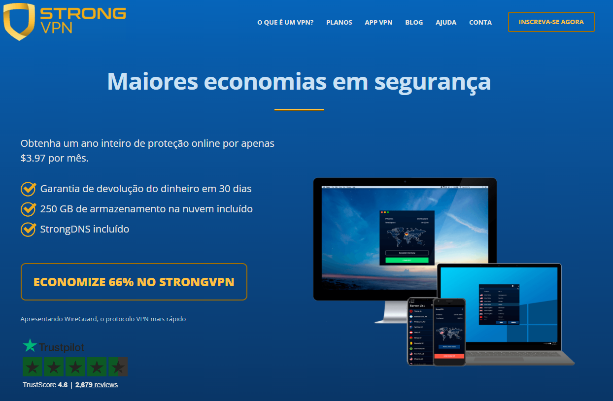

#### Passo 2: Instale o App
Execute o arquivo baixado. Permita permissões quando solicitado (ex.: "Sim" pra instalar componentes de rede). Confirme lançar ao iniciar se perguntar.  
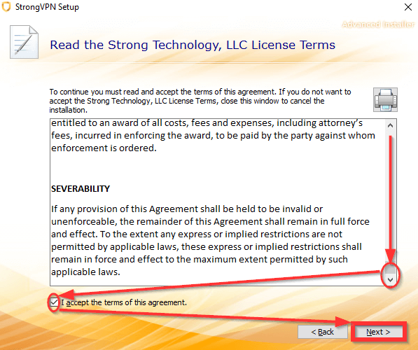

#### Passo 3: Faça Login
Digite seu e-mail e senha (enviados no cadastro).  
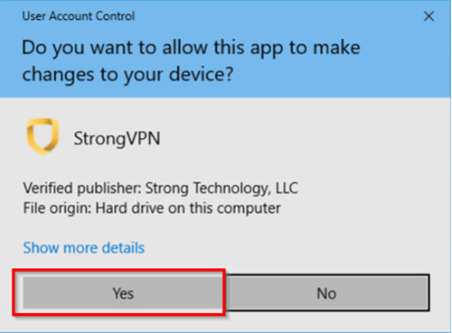

#### Passo 4: Conecte
Use "Best Available Location" pra auto-mais rápido, ou escolha manual. Melhores estáveis dos testes: Reino Unido, Japão, Austrália, Singapura, EUA Oeste. Clique Connect — você está online!  
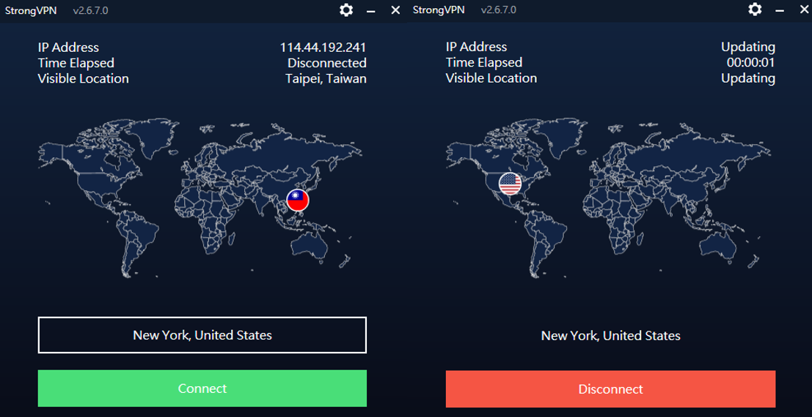

### Tutorial de Instalação ExpressVPN
Setup premium — apps super limpos.

#### Passo 1: Compre & Pegue Código de Ativação
Use nosso link de oferta: [Oferta ExpressVPN](https://go.expressvpn.com/c/3828265/1634695/16063) → Compre → Faça login no dashboard pra pegar seu código de ativação. Baixe da [página oficial Mac](https://www.expressvpn.com/vpn-software/vpn-mac) (detecta auto). Exemplo Mac mostrado.  
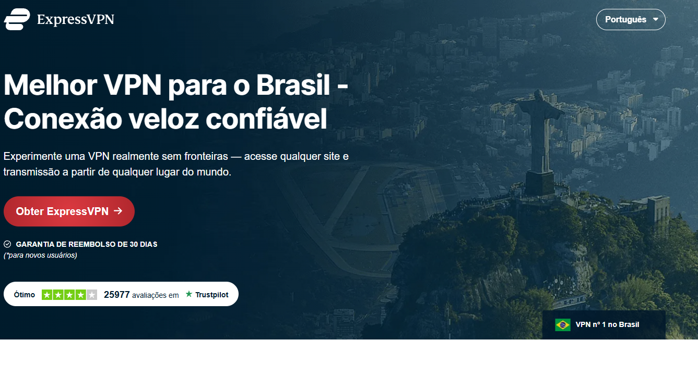

#### Passo 2: Instale
Abra o arquivo .pkg. Clique "Continuar" nos prompts, escolha local de instalação, digite senha se pedir. Aguarde finalizar.  
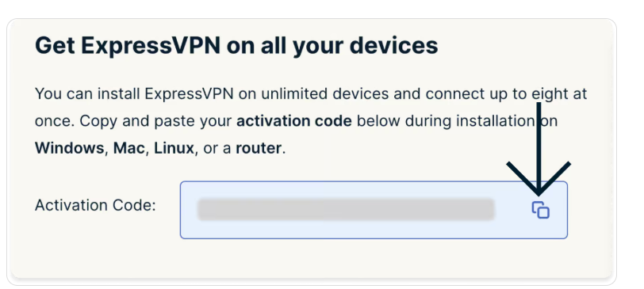

#### Passo 3: Faça Login
Abra o app → Entre com e-mail/senha ou cole o código de ativação. Permita config IKEv2 quando pedir (prompt de segurança Mac).  
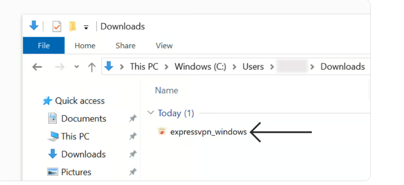  
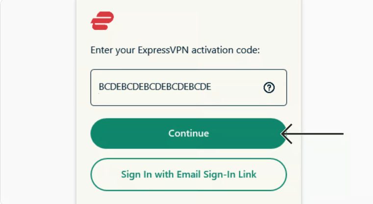

#### Passo 4: Conecte
Clique no botão de conexão e use "Smart Location" ou escolha o país necessário. Teste o serviço principal; o Basic permite até 10 conexões simultâneas.
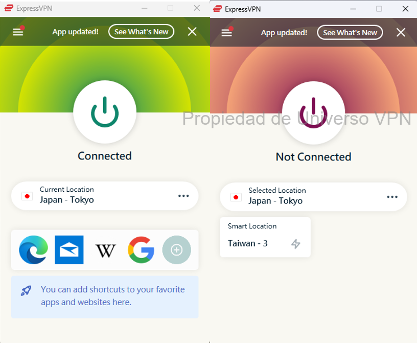

### Tutorial de Instalação Surfshark
Dispositivos ilimitados — favorito das famílias.

#### Passo 1: Baixe & Instale
Após compra, baixe do site oficial ou dashboard. Execute instalador → Permita permissões em cada prompt ("Sim").  
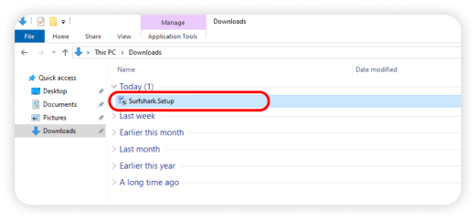  
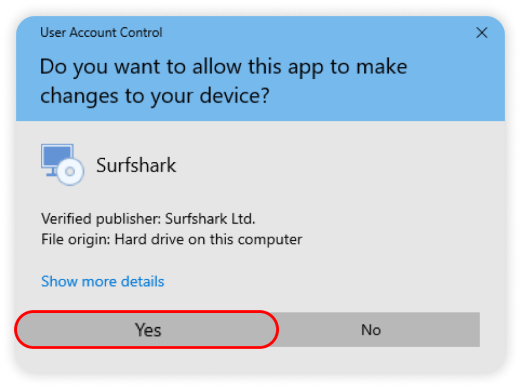

#### Passo 2: Faça Login
Abra o app → Digite e-mail & senha do cadastro.  
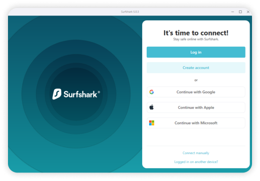

#### Passo 3: Conecte
Clique "Quick-connect" ou escolha na barra lateral (Fastest Server auto-escolhe). Status mostra "Connected". Uso simultâneo ilimitado!  

### Tutorial de Instalação FlowVPN
Ótima pro teste de 3 dias.

#### Passo 1: Baixe
Após cadastro/trial: Baixe do site oficial (exemplo Windows).  
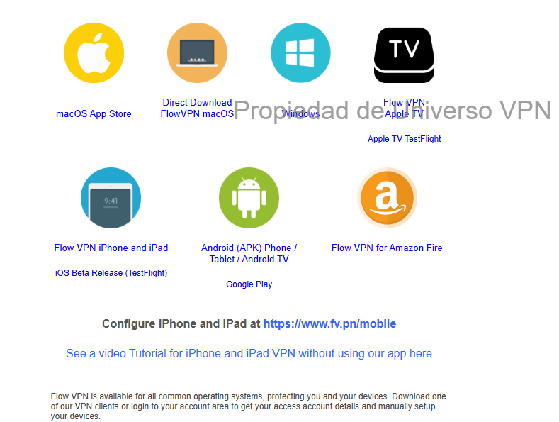

#### Passo 2: Instale & Conecte
Execute instalador → Complete setup. Abra app → Faça login com credenciais do trial. Clique "Connect" → Escolha país/servidor do menu. Mostra "FlowVPN connected" quando ativo.  
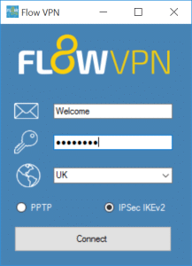

## O Que Você Pode Fazer com uma VPN + Precauções Importantes

Uma vez conectado, uma boa VPN libera a internet aberta completa — streaming, redes sociais, notícias, aprendizado, games e mais. Veja o que fica instantaneamente acessível:

- **Redes Sociais & Mensagens**: Twitter/X, Facebook, Instagram, YouTube, WhatsApp, Telegram, Line
- **Plataformas de Streaming**: Netflix (todas as bibliotecas), Hulu, HBO Max, Disney+, BBC iPlayer
- **Busca & Comunidades**: Google, Bing, DuckDuckGo, Reddit, Quora, Stack Overflow/Exchange, Medium, Wikipedia
- **Notícias Globais**: CNN, BBC, New York Times, Washington Post, Guardian, Reuters, Al Jazeera, Bloomberg
- **Games & Downloads**: Steam, Epic Games, Origin, Battle.net, GOG, Twitch; sites de torrent (use servidores P2P)
- **Ferramentas Seguras**: ProtonMail (e-mail criptografado), Tor (anonimato extra), Coursera/Udemy/LinkedIn Learning

### Tabela de Referência Rápida – Principais Sites por Categoria

| Categoria             | Opção 1                         | Opção 2                      | Opção 3                         | Opção 4                    | Opção 5                    |
|-----------------------|---------------------------------|------------------------------|---------------------------------|----------------------------|----------------------------|
| Streaming de Vídeo    | [Netflix](https://www.netflix.com/) | [Hulu](https://www.hulu.com/) | [Amazon Prime Video](https://www.primevideo.com/) | [BBC iPlayer](https://www.bbc.co.uk/iplayer) | [Disney+](https://www.disneyplus.com/) |
| Streaming de Música   | [Spotify](https://www.spotify.com/) | [Pandora](https://www.pandora.com/) | [Apple Music](https://www.apple.com/apple-music/) | [Tidal](https://tidal.com/) | [SoundCloud](https://soundcloud.com/) |
| Acadêmico/Pesquisa    | [Google Scholar](https://scholar.google.com/) | [arXiv](https://arxiv.org/) | [IEEE Xplore](https://www.ieee.org/) | [JSTOR](https://www.jstor.org/) | [PubMed](https://pubmed.ncbi.nlm.nih.gov/) |
| Motores de Busca      | [Google](https://www.google.com/) | [Bing](https://www.bing.com/) | [DuckDuckGo](https://duckduckgo.com/) | [Yahoo](https://www.yahoo.com/) | [Startpage](https://www.startpage.com/) |
| Quadrinhos/Mangá/Anime| [Marvel Unlimited](https://www.marvel.com/unlimited) | [DC Universe](https://www.dcuniverse.com/) | [ComiXology](https://www.comixology.com/) | [Crunchyroll](https://www.crunchyroll.com/) | [Webtoon](https://www.webtoons.com/) |
| Notícias Internacionais | [CNN](https://www.cnn.com/) | [BBC](https://www.bbc.com/) | [Wall Street Journal](https://www.wsj.com/) | [The Guardian](https://www.theguardian.com/) | [Al Jazeera](https://www.aljazeera.com/) |
| Cursos Online         | [Coursera](https://www.coursera.org/) | [edX](https://www.edx.org/) | [Khan Academy](https://www.khanacademy.org/) | [Udemy](https://www.udemy.com/) | [LinkedIn Learning](https://www.linkedin.com/learning/) |
| Redes Sociais         | [Facebook](https://www.facebook.com/) | [Instagram](https://www.instagram.com/) | [Twitter/X](https://twitter.com/) | [LinkedIn](https://www.linkedin.com/) | [Pinterest](https://www.pinterest.com/) |

**Precauções & Melhores Práticas**:
- Use VPN de forma legal no seu país — evite atividades ilegais.
- Nunca use VPNs grátis/desconhecidas pra tarefas sensíveis (banco, e-mails) — risco de logs/anúncios/malware.
- Ative sempre kill switch + auto-conexão.
- Teste velocidades/servidores regularmente.
- Pra torrents: Fique nos servidores otimizados pra P2P (Surfshark/StrongVPN).
- Antes de renovar, compare o preço da conta com o checkout atual e peça ao suporte uma oferta válida para clientes existentes.

Teste o provedor com os serviços que você realmente usa e avalie velocidade real, qualidade do app e suporte.

### Usar VPN pra Burlar Restrições é Ilegal?
Na maioria dos países, usar VPN em si é **perfeitamente legal** — milhões fazem isso diariamente por privacidade, trabalho, viagens e streaming. No entanto, alguns lugares (como China, Rússia, Irã, Coreia do Norte e outros) restringem ou proíbem VPNs não autorizadas. Mesmo nesses casos, **a aplicação contra usuários individuais** (turistas, expatriados ou usuários casuais) é extremamente rara — as repressões geralmente miram provedores, não pessoas comuns.

O maior problema: Autoridades frequentemente bloqueiam sites/apps de VPN, dificultando baixar uma depois que você já está restrito.  
**Melhor Prática**: Sempre baixe e configure sua VPN **antes** de entrar em área restrita. Fique com provedores comprovados e confiáveis como **ExpressVPN** (ofuscação top & atualizações rápidas) ou **StrongVPN** (ótimo pra pagamentos internacionais & estabilidade).  

**Nota Importante**: Nunca use VPN pra atividades ilegais. Fique dentro das leis locais pra minimizar qualquer risco.

## Por Que Não Recomendamos VPNs Grátis – Os Riscos Reais

VPNs grátis parecem tentadoras pra lidar com bloqueios regionais, mas quase sempre vêm com desvantagens sérias que superam qualquer benefício "grátis".

- **Privacidade & Venda de Dados**: Muitas registram e vendem seu histórico de navegação, localização e dados pessoais pra anunciantes ou terceiros — o oposto do que uma VPN deveria fazer.
- **Desempenho Horrível**: Velocidades lentas, desconexões frequentes, tempos de espera longos e limites de dados (ex.: 500MB–2GB/dia) tornam streaming ou navegação dolorosos.
- **Malware & Riscos de Segurança**: Algumas embutem adware, spyware, mineradores de cripto ou até roubam credenciais/info bancária. Apps grátis são vetores comuns de malware.
- **Problemas Legais & Estabilidade**: Muitas operam em áreas cinzentas ou fecham de repente, deixando usuários expostos.
- **Sem Suporte Real**: Zero ajuda ao cliente, sem atualizações contra novos bloqueios — você fica sozinho.

**Exemplos do Mundo Real**: Usuários de VPNs grátis como Lantern, Hola, Betternet ou SuperVPN relataram vazamentos de dados, roubo de contas ou até multas em regiões rígidas. Uma única brecha pode custar muito mais que uma assinatura paga de $3–6/mês.

**Resumo:** um plano grátis pode servir para uso limitado, mas leia financiamento, dados, anúncios, países e franquia. Como referência paga, o Surfshark Starter mostra US$67,23 pelos primeiros 27 meses (≈R$385 / €61,18), com imposto quando aplicável; confirme renovação no checkout.

## Por Que Não Recomendamos Criar Sua Própria VPN

Configurar um servidor VPN pessoal (ex.: em VPS como DigitalOcean/AWS com OpenVPN/WireGuard) parece inteligente pra controle — mas raramente é prático pra lidar com restrições regionais.

- **Complexidade Técnica**: Exige conhecimento profundo de setup de servidor, criptografia, protocolos, regras de firewall, gerenciamento de certificados e manutenção constante. Um erro de config = vazamentos ou bloqueios.
- **Riscos Legais**: Em regiões restritas, rodar sua própria VPN pode chamar mais atenção que usar uma comercial — algumas leis miram explicitamente serviços "não autorizados".
- **Custos & Esforço Altos**: Aluguel de VPS ($5–20/mês), taxas de banda, setup de domínio, rotação de IP pra evitar bloqueios — soma rápido e tira tempo de usar a internet de verdade.
- **Desempenho & Estabilidade Ruins**: Setups de servidor único são bloqueados rápido; sem rede global, sem ofuscação, sem balanceamento de carga. Provedores comerciais investem milhões em tech anti-bloqueio.

**Veredito**: A menos que você seja especialista em redes com tempo e recursos, criar a sua é mais dor de cabeça que vale. Provedores comerciais cuidam das partes difíceis pra você não precisar.

## Conhecimento Essencial de VPN que Todo Mundo Deveria Entender

#### Qual é o Princípio Central de uma VPN?
VPN = Rede Privada Virtual. No fundo, é **criptografia**. Seus dados são embaralhados (usando matemática forte como AES-256) em um código ilegível — só o servidor VPN (com a chave certa) consegue desembaralhar.  
Todo seu tráfego viaja por um túnel criptografado antes de chegar à internet aberta. Isso esconde não só seu IP, mas também metadados que seu navegador vaza (fuso horário, idioma, SO, resolução de tela, fontes) — que podem criar uma "impressão digital" única pra rastreamento por provedores, anunciantes ou governos. Uma boa VPN bloqueia isso na hora.

#### O Que São Restrições de Rede Globais ("filtros rígidos de rede")?
Algumas regiões impõem controles rígidos de internet — filtragem, monitoramento e bloqueio em escala massiva. As mais avançadas usam:
- Bloqueio de IP
- Envenenamento de DNS
- Filtragem de URL
- Inspeção profunda de pacotes
- Reset de conexões

Sites populares (Google, YouTube, Facebook, Twitter/X, WhatsApp, veículos de notícias) costumam ser os primeiros alvos. Ferramentas como OONI Probe ou GreatFire.org mostram domínios bloqueados em tempo real — a escala é enorme e evolui constantemente.

#### O Que uma VPN Realmente Pode Fazer por Você?
Ao rotear por um servidor remoto e mudar seu IP/localização visível, uma VPN libera:

- **Bibliotecas de Streaming**: Netflix completa, Hulu, Disney+, BBC iPlayer, Amazon Prime em outros países.
- **Burlar Censura**: Acessar notícias bloqueadas, redes sociais, fóruns.
- **Proteção de Privacidade**: Esconder IP, criptografar tráfego, impedir espionagem de provedor/governo.
- **Wi-Fi Público Seguro**: Navegação segura em cafés, aeroportos, hotéis.
- **Acesso Remoto**: Conectar a redes de trabalho/escola com segurança.

Use com responsabilidade e legalidade — VPNs são ferramentas de liberdade e privacidade, não pra violar leis.

Teste o provedor com os serviços que você realmente usa e avalie velocidade real, qualidade do app e suporte.

#### As VPNs São Realmente Eficazes?
A eficácia das VPNs é debatida, mas depois de anos testando diariamente em regiões restritas, aqui vai a verdade direta: **Sim, VPNs premium pagas são altamente eficazes** quando você escolhe as confiáveis como **ExpressVPN** (melhor pra bloqueios difíceis e velocidade) ou **StrongVPN** (ótimo custo-benefício e pagamentos internacionais). Elas burlam restrições consistentemente, protegem privacidade e entregam velocidades usáveis pra streaming/games/trabalho.

Dito isso, ceticismo é justo. Algumas "VPNs" têm histórico suspeito:
- Onavo do Facebook (Project Atlas) pagava $20/mês pros usuários pra ter acesso root e coleta profunda de dados — era basicamente spyware disfarçado de VPN.
- Hola VPN transformava usuários grátis em botnet involuntário (vendendo banda deles), só corrigiu após backlash massivo.

**Teste Rápido de Eficácia**:
1. Conecte a um servidor em outro país.
2. Visite whatismyipaddress.com — seu IP deve mudar pro do servidor.
3. Tente acessar um site bloqueado (ex.: Google, YouTube ou biblioteca US da Netflix).
4. Rode ipleak.net ou dnsleaktest.com — sem vazamentos significa que está funcionando direito.

Se passar nesses testes, é eficaz. VPNs premium pagas passam com consistência; grátis/baratas geralmente falham ou vazam.

#### Precisa de VPN em Hong Kong?
- **Redes fortemente reguladas**: filtros rígidos podem bloquear serviços internacionais importantes.

**Sim, VPN é recomendada** pra proteção de privacidade contra rastreamento potencial de provedores/governo/hackers — especialmente pra jornalistas, ativistas ou quem discute temas sensíveis. Também ajuda a acessar notícias/streaming internacionais sem interferência.

#### Precisa de VPN em Taiwan?
Taiwan tem uma das internets mais livres do mundo — sem censura generalizada, velocidades rápidas e direitos digitais fortes. Pra navegação/streaming/redes sociais do dia a dia, **você não precisa estritamente de VPN** pra lidar com bloqueios regionais.

Porém, é **muito útil** pra:
- Privacidade em Wi-Fi público (cafés, metrô, aeroportos — alvos comuns de hackers).
- Evitar rastreamento de provedor/anunciantes.
- Acessar conteúdo geo-restrito (ex.: Netflix US, BBC iPlayer).
- Segurança extra em viagens ou redes compartilhadas.

Resumindo: Não obrigatório, mas inteligente pra quem valoriza privacidade.

#### Onde Mais as Pessoas Realmente Precisam de VPN (Além de Regiões Específicas)?
Embora áreas altamente restritas impulsionem mais o uso de VPN, pessoas em todo lugar se beneficiam por motivos diferentes:

- **Rússia**: Bloqueia Facebook, Instagram, Twitter/X, BBC, notícias independentes — VPNs são essenciais pra acesso sem censura.
- **Irã**: Filtragem severa de redes sociais, notícias e apps — VPNs são necessidade diária.
- **Turquia**: Bloqueios periódicos em Twitter/X, YouTube, Wikipedia — VPNs restauram acesso.
- **Emirados Árabes/ Arábia Saudita**: Apps VoIP (chamadas WhatsApp, Skype, FaceTime) bloqueados — VPNs liberam.
- **Países com filtros rígidos de rede**: algumas regiões bloqueiam redes sociais, notícias, apps de chamada ou serviços internacionais — verifique a lei local antes de viajar.
- **Mesmo em países "livres"** (EUA, Reino Unido, Europa, Austrália, Taiwan, Japão etc.):
  - Privacidade contra rastreamento de provedor/anunciantes/governo.
  - Segurança em Wi-Fi público.
  - Burlar geo-bloqueios pra passagens mais baratas, bibliotecas de streaming ou ferramentas de trabalho.

Resumo final: VPNs não são só pra regiões censuradas — são pra qualquer um que queira privacidade, segurança e acesso total à internet.

### Meu VPN Pago Não Está Funcionando – O Que Fazer?
VPNs pagas falham menos, mas quando acontecem, siga essa ordem de troubleshooting (funciona pra ExpressVPN, Surfshark, StrongVPN etc.):

1. **Verificações Básicas & Reinício**:
   - Confirme usuário/senha/código de ativação.
   - Reinicie dispositivo + roteador + app da VPN.
   - Atualize o app pra versão mais recente.

2. **Soluções Rápidas**:
   - Troque de servidor (tente "Melhor/Mais Rápido" ou países próximos).
   - Mude protocolo (WireGuard → IKEv2 → OpenVPN UDP/TCP).
   - Ative modo ofuscação/Camouflage/NoBorders se disponível.
   - Teste com dados móveis em vez de Wi-Fi.

3. **Passos Avançados**:
   - Limpe cache do app (configurações no app ou dispositivo).
   - Reinstale o app.
   - DNS custom: Tente 8.8.8.8 + 8.8.4.4 (Google) ou 1.1.1.1 (Cloudflare).

4. **Contate Suporte**:
   - Use chat ao vivo 24/7 (ExpressVPN/Surfshark/StrongVPN todos têm ótimos).
   - Forneça: dispositivo/SO, mensagem de erro, o que você já tentou.
   - Eles frequentemente diagnosticam remotamente, enviam configs custom ou reembolsam se não resolver.

A maioria dos problemas resolve em minutos com suporte. Se ainda falhar, troque pro seu backup VPN (sempre tenha 2–3 instaladas).  

Teste o provedor com os serviços que você realmente usa e avalie velocidade real, qualidade do app e suporte.

## Usos Avançados & Benefícios de VPN

### Double ou Multi-Hop VPNs – Como & Por Que Usar

Uma double (ou multi-hop) VPN roteia seu tráfego por **dois ou mais servidores** em vez de um — sua conexão vai: Você → Servidor 1 → Servidor 2 → Internet. Isso adiciona uma camada extra de proteção, embora geralmente reduza um pouco a velocidade.

#### Principais Vantagens
1. **Privacidade & Anonimato Mais Fortes**  
   Seu IP real fica escondido atrás do primeiro servidor, então mesmo se o segundo for comprometido ou intimado, ele só vê o IP do primeiro — não o seu. Torna rastrear sua atividade extremamente difícil.

2. **Defesa Extra Contra Vigilância & Vazamentos**  
   Ideal pra cenários de alto risco: acessar dados sensíveis em Wi-Fi público (cafés, aeroportos, hotéis), jornalismo em regiões monitoradas, ou quem é paranoico com logging de provedor/governo. Se um hop falhar ou for atacado, o segundo ainda te protege.

3. **Melhor pra Burlar Censura Pesada**  
   Em lugares com filtragem agressiva (ex.: Rússia, Irã ou certas redes empresariais), encadear servidores de países/jurisdições diferentes evade detecção mais confiavelmente que um único hop.

**Como Configurar**  
- **Multi-Hop Integrado**: Surfshark (MultiHop), ProtonVPN (Secure Core), NordVPN (Double VPN) — ative nas configurações do app.  
- **Encadeamento Manual**: Conecte em uma VPN (ex.: StrongVPN), depois rode uma segunda (ex.: ExpressVPN) por cima — funciona mas mais complexo e mais lento.  
- **Melhor Pra**: Extremistas de privacidade ou usuários em áreas altamente monitoradas.  
**Contrapartida**: Espere queda de 10–30% na velocidade por dupla criptografia & roteamento. Use só quando privacidade > desempenho.

### Como VPNs Afetam a Velocidade da Internet – Real Talk

VPNs adicionam segurança, privacidade e acesso global — mas quase sempre deixam as coisas um pouco mais lentas. Aqui está exatamente o porquê, e quanto esperar em 2026.

#### Principais Motivos da Perda de Velocidade
1. **Sobrecarga de Criptografia**  
   Criptografar/descriptografar cada pacote consome CPU e adiciona atrasos minúsculos. Protocolos modernos como WireGuard minimizam isso (geralmente <5–10% de perda em hardware bom), enquanto os antigos (OpenVPN) podem chegar a 20–40%.

2. **Distância do Servidor**  
   Física manda: Quanto mais longe o servidor, maior latência e menor velocidade. Conectar a um servidor 10.000 km distante adiciona ping e reduz throughput.  
   **Regra de Ouro**: Escolha servidores na sua região ou próximos — ex.: Taiwan → Japão/Singapura/Hong Kong pra melhores velocidades.

3. **Carga & Qualidade do Servidor**  
   Horários de pico sobrecarregam servidores populares → velocidades mais lentas. Provedores premium (ExpressVPN, Surfshark) investem em infraestrutura massiva e auto-otimizam pro servidor menos carregado/mais rápido.

4. **Sua Conexão Base**  
   VPN não faz sua internet ficar mais rápida do que ela já é. Se seu provedor dá 100 Mbps mas você tem interferência Wi-Fi ou roteador antigo, VPN vai destacar esses problemas mais.

#### Expectativas Realistas (Testes 2026)
- Em fibra 1 Gbps + WireGuard + servidor próximo: 700–950 Mbps (perda 5–30%, muitas vezes imperceptível pra streaming/games).  
- Servidor distante ou protocolo antigo: 300–600 Mbps (ainda ótimo pra Netflix 4K, Zoom, downloads).  
- Multi-hop: 200–500 Mbps (usável mas perceptível em uso pesado).

**Dicas pra Minimizar Perda de Velocidade**  
- Use WireGuard ou Lightway (ExpressVPN).  
- Escolha "Servidor Mais Rápido" ou locais próximos.  
- Teste com speedtest.net antes/depois de conectar.  
- Evite VPNs grátis/baratas — elas throttlam ou limitam pesado.  
- Atualize roteador/modem se velocidade base for baixa.

Resumo final: Com uma boa VPN paga e escolhas inteligentes, a perda de velocidade é mínima — você ganha privacidade e acesso sem sacrificar usabilidade diária.

Agora você está equipado com dicas avançadas pra tirar o máximo da sua VPN. Escolha o setup certo pras suas necessidades, teste e curta navegação segura e com menos bloqueios regionais.
**Conclusão**: Impacto na velocidade varia muito por provedor, protocolo, escolha de servidor e sua conexão base. VPNs premium (ExpressVPN, Surfshark, StrongVPN) mantêm perdas mínimas — geralmente 5–20% em setups bons — enquanto entregam excelente privacidade e acesso. Teste com "Servidor Mais Rápido" + WireGuard, e você mal vai notar diferença pra streaming 4K, games ou downloads.

### O que fazer quando streaming bloqueia a VPN

Serviços de vídeo bloqueiam IPs de VPN o tempo todo. Se um servidor falhar, teste outro antes de concluir que a VPN não presta.

- Troque para outro servidor no mesmo país.
- Limpe cookies ou use outro navegador.
- Confira DNS/WebRTC.
- No celular, verifique permissões de localização.
- Teste no horário em que você realmente assiste futebol, séries ou notícias.

Para Brasil e Portugal, isso é mais útil que ferramentas técnicas de proxy. O que importa é saber se a VPN abre suas plataformas dentro do prazo de reembolso.

## Usos Avançados & Compatibilidade de VPN

### Por Que & Como Rotacionar/Trocar Provedores de VPN Regularmente pra Mais Segurança

Mesmo com uma VPN sólida, rotacionar provedores a cada poucos meses adiciona uma camada extra de proteção — reduz risco de rastreamento a longo prazo se um provedor enfrentar breach, intimação ou logging não detectado.

#### Passos pra Rotacionar com Segurança
1. **Defina um Cronograma**: A cada 3–6 meses (ou após notícias grandes como auditorias/breaches). Alinhe com orçamento — muitos têm deals longos.
2. **Pesquise o Próximo**: Priorize no-logs auditado, ofuscação forte, localizações necessárias e recursos (ex.: dispositivos ilimitados no Surfshark, velocidade top na ExpressVPN).
3. **Remova Completamente a Antiga**:
   - Desinstale o app totalmente.
   - Delete configs/perfis.
   - Reinicie dispositivo pra limpar configurações de rede residuais.
4. **Teste a Nova a Fundo**:
   - Testes de velocidade (speedtest.net).
   - Verificações de vazamento (ipleak.net, dnsleaktest.com).
   - Testes de streaming/games.
   - Estabilidade por alguns dias.
5. **Dica Bônus**: Mantenha 2–3 instaladas como backup — troque rápido se uma for bloqueada.

É esforço extra, mas pra usuários de alta privacidade é um hábito inteligente. A maioria fica com um ótimo provedor a longo prazo — mas rotacionar dá paz de espírito.

### Como verificar o FlowVPN na Apple TV

A disponibilidade do FlowVPN na Apple TV pode mudar conforme país, versão do tvOS e distribuição do aplicativo. Consulte primeiro a página oficial atual do [FlowVPN para Apple TV](https://www.flowvpn.com/apple-tv/) e não dependa de convites TestFlight antigos ou expirados.

#### Verificação antes de pagar
1. Procure o aplicativo oficial na App Store da Apple TV e confira o desenvolvedor.
2. Confirme compatibilidade com seu modelo, tvOS e país.
3. Antes de iniciar o [teste de 3 dias](https://www.flowvpx.com/sign-up/?locale=pt&special=FREETRIAL&r=35-890485.w_github), confira no PayPal o valor posterior e o prazo de cancelamento.
4. Teste login, reprodução, legendas e estabilidade por pelo menos 20 minutos no serviço que você realmente usa.

Ter um aplicativo compatível não garante que toda plataforma de vídeo funcione em qualquer rede. Decida pelo resultado no seu próprio aparelho.

### VPNs & Desbloqueio da Netflix – Como Funciona em 2026
Netflix continua sendo o maior serviço de streaming do mundo, com bibliotecas que mudam drasticamente por país — EUA tem o maior catálogo, enquanto outras regiões recebem séries/filmes diferentes por licenciamento. Uma VPN muda sua localização virtual pra aparecer em país suportado, liberando acesso total.

Netflix aumentou detecção de VPN ao longo dos anos (blacklist de IP, análise comportamental), mas provedores premium ainda burlam com confiabilidade por atualizações frequentes de servidores, ofuscação e IPs dedicados pra streaming. Testamos mensalmente em conexões reais — aqui está o ranking atual (janeiro 2026) pra desbloqueio consistente da Netflix:

| Provedor VPN | Regiões Desbloqueadas Confiáveis (Testado Jan 2026)           | Notas / Destaque de Desempenho |
|--------------|----------------------------------------------------------------|--------------------------------|
| ExpressVPN   | US, Canadá, Reino Unido, França, Japão, Austrália, Alemanha, Brasil | Consistência e velocidade top pra 4K; raramente precisa trocar servidor |
| StrongVPN    | US, Reino Unido, Alemanha, Japão, Canadá, Austrália           | Excelente custo-benefício; forte em US/Reino Unido |
| Surfshark    | Canadá, Austrália, Japão, Alemanha, US, Reino Unido, Países Baixos | Dispositivos ilimitados + ótimo suporte multi-região |
| FlowVPN      | US, Canadá, Reino Unido, Austrália, Japão, Alemanha            | Bom pra tudo; ótimo pra necessidades mistas de streaming |

**Dica de Mestre**: Sempre conecte em servidores "otimizados pra streaming" ou próximos. Se um falhar, troque — VPNs premium rotacionam IPs rápido. Evite grátis — Netflix bloqueia quase instantaneamente.

### VPNs & Desbloqueio da Disney+ – Status Atual
Conteúdo da Disney+ também varia muito por região (ex.: exclusivos Marvel/Star Wars diferem, mais originais locais). Uma VPN falsifica localização pra acessar bibliotecas mais completas, mas detecção da Disney+ melhorou (similar à Netflix). Testes mensais mantêm nossa lista fresca:

| Provedor VPN | Regiões Desbloqueadas Confiáveis (Testado Jan 2026)           | Notas / Destaque de Desempenho |
|--------------|----------------------------------------------------------------|--------------------------------|
| ExpressVPN   | França, US, Austrália, Canadá, Reino Unido, Japão, Alemanha    | Melhor geral pra Disney+ — carregamento rápido, erros raros |
| StrongVPN    | Reino Unido, US, África do Sul, Austrália, Canadá, Alemanha    | Forte em US/Reino Unido; bom pra viagens internacionais |
| Surfshark    | US, Reino Unido, Canadá, Austrália, Japão, Países Baixos, França | Conexões ilimitadas para casas com muitos aparelhos |
| FlowVPN      | US, Reino Unido, Alemanha, Austrália, Japão, Canadá            | Desempenho confiável; ótimo pra usuários Apple TV |

**Conselho Rápido pros Dois Serviços**:
- Use protocolo WireGuard ou Lightway pra streaming mais rápido.
- Ative kill switch pra evitar exposição acidental.
- Teste em dispositivo não crítico primeiro se novo no provedor.
- Rotacione servidores se um for marcado — top VPNs têm centenas prontos.

Esses quatro entregam consistentemente nos nossos testes de 2026 — ExpressVPN lidera em confiabilidade premium, Surfshark em custo-benefício/ilimitado, StrongVPN em orçamento internacional e FlowVPN em inovação Apple TV. Escolha de acordo com seus dispositivos e prioridades, e curta os catálogos globais sem fronteiras.

## Protocolos VPN para uso diário

Comece pelo modo automático do aplicativo. Só troque protocolo se a velocidade cair, se o app de streaming falhar ou se a rede do hotel/escola bloquear a conexão.

| Protocolo | Melhor uso | Observação |
|---|---|---|
| WireGuard / Lightway | streaming e velocidade | geralmente a primeira escolha |
| OpenVPN UDP | equilíbrio entre velocidade e estabilidade | bom para Wi-Fi doméstico |
| OpenVPN TCP | redes públicas ou restritivas | pode ser mais lento, mas conecta melhor |
| IKEv2 | celular e troca entre Wi-Fi/4G/5G | útil para viagem |

### Diferenças & Casos de Uso: VPN vs. Tor

**VPN** (Rede Privada Virtual) e **Tor** (The Onion Router) aumentam privacidade e segurança, mas são construídos pra objetivos diferentes.

#### 1. VPN: Criptografia + Velocidade + Versatilidade
- **Criptografa todo tráfego**: Túnel completo de ponta a ponta esconde tudo de provedores/hackers.
- **Esconde seu IP**: Você aparece na localização do servidor VPN.
- **Burla geo-bloqueios**: Excelente pra streaming (Netflix, Disney+), games, trabalho.
- **Fator confiança**: Depende do provedor — escolha auditados no-logs (ExpressVPN, Surfshark, StrongVPN).
- **Velocidade**: Geralmente rápida (perda mínima com WireGuard).
- **Melhor pra**: Privacidade diária, streaming, segurança em Wi-Fi público, acesso remoto.

#### 2. Tor: Anonimato Máximo + Roteamento Multi-Camadas
- **Criptografia tripla**: Dados pulam por três nós voluntários aleatórios (entrada → meio → saída) — nenhum nó sabe o caminho completo.
- **Anonimato forte**: Extremamente difícil rastrear de volta pra você.
- **Acesso à dark web**: Habilita sites .onion.
- **Desvantagens**: Muito mais lento (por multi-hop + relays voluntários), não ideal pra streaming/chamadas de vídeo, nós de saída podem ser monitorados (use sempre HTTPS).
- **Percepção**: Muitas vezes ligado a atividades ilegais (embora a maioria do uso seja privacidade legítima).

**Quando Escolher Qual**  
- **VPN** pra velocidade, streaming, games, privacidade geral e lidar com geo-restrições.  
- **Tor** pra anonimato máximo (ex.: denunciantes, jornalistas em áreas de alto risco) ou acessar serviços ocultos.  
Muitos combinam: VPN pro dia a dia + Tor Browser pra sessões sensíveis.

Escolha pelo seu modelo de ameaça: VPN e Tor resolvem problemas diferentes e têm contrapartidas distintas de velocidade e confiança.

### VPN vs. Servidores Proxy – Diferenças Chave
VPNs e proxies oferecem algum nível de anonimato, mas funcionam muito diferente em segurança, velocidade e proteção.

#### 1. Como Funcionam
- **VPN**: Constrói túnel totalmente criptografado entre seu dispositivo e servidor, mascarando **todo** tráfego com IP do servidor. Tudo (navegação, apps, downloads) fica privado.
- **Proxy**: Age como intermediário — encaminha requisições e respostas mas sem criptografia completa. Só esconde IP pra apps/navegadores específicos, deixando dados expostos.

#### 2. Segurança & Privacidade
- **VPN**: Criptografa o tráfego entre o aparelho e o servidor VPN, reduzindo a exposição em Wi-Fi público. Não protege contra phishing, malware, conta comprometida ou todos os tipos de rastreamento.
- **Proxy**: Mascaramento básico de IP apenas. Sem criptografia significa que seus dados (senhas, e-mails) podem ser interceptados facilmente.

#### 3. Velocidade & Desempenho
- **VPN**: Pequena sobrecarga pela criptografia, mas provedores premium (protocolo WireGuard) mantêm mínima — ótimo pra streaming/games.
- **Proxy**: Muitas vezes mais rápido (sem criptografia), mas proxies públicos são sobrecarregados, não confiáveis e arriscados.

**Resumo Final**: VPNs vencem em segurança real e privacidade completa. Proxies são ok pra anonimato rápido e leve (ex.: um site só) mas não pra uso diário.

## Protocolos Comuns de VPN Explicados

Uma VPN (Rede Privada Virtual) te conecta à internet por um túnel seguro e criptografado — bloqueando espiões, rastreadores e interferências. Diferentes protocolos equilibram velocidade, segurança e compatibilidade. Aqui vai o resumo dos mais populares:

- **PPTP**: Mais antigo e simples — setup super fácil, funciona em qualquer lugar, mas segurança fraca (evite pra qualquer coisa sensível).
- **L2TP/IPsec**: Aumento sólido de segurança sobre PPTP, favorito de empresas — precisa de mais setup mas desempenho confiável.
- **SSTP**: Criptografia forte + velocidade, principalmente pra usuários Windows (apoiado pela Microsoft).
- **IKEv2/IPsec**: Potência moderna — reconexões ultrarrápidas (ótimo pra celular), segurança top.
- **OpenVPN**: Rei open-source — ultra-seguro, funciona em todo dispositivo (Windows, Mac, Linux, Android, iOS, roteadores).
- **WireGuard** (estrela mais nova): Protocolo mais leve & rápido — perda mínima de velocidade, segurança à prova de futuro. Usado por Surfshark, StrongVPN, ExpressVPN.

**Dica de Mestre**: A maioria dos apps auto-escolhe o melhor (WireGuard/OpenVPN). Pra velocidade máxima em games/streaming, priorize WireGuard; pra segurança máxima, OpenVPN.

## Melhores Recursos de VPN pra Games – Suba de Nível no Seu Jogo

No mundo global de games de hoje, você enfrenta restrições de servidor, ping alto, filtros de rede e geo-bloqueios. Uma VPN sólida resolve tudo — conecte em qualquer região, destrua lag e jogue multiplayer sem travar como FIFA/EA FC, Valorant ou Fortnite.

Recomendamos **ExpressVPN** e **StrongVPN** como tops pra games — testadas em batalha pra baixa latência e confiabilidade.

### Como VPN Turbina Seus Games
- **Acesso Antecipado**: Games lançam conteúdo primeiro em certas regiões? VPN te "teletransporta" pra lá e joga antes.
- **Burlar Geo-Bloqueios**: Libere servidores regionais bloqueados, eventos ou elencos completos (ex.: modos Copa do Mundo FIFA).
- **Reduzir Lag/Ping**: Servidores otimizados próximos cortam latência — jogue como se estivesse local.
- **Proteção DDoS**: Esconde seu IP real de atacantes em partidas competitivas.
- **Wi-Fi Público Seguro**: Jogue em cafés/torneios sem hackers roubando contas.

### Por Que ExpressVPN & StrongVPN Dominam Games
- **ExpressVPN**: rede anunciada em 113 países, Smart Location e protocolo Lightway. Teste latência e estabilidade no PC, celular, TV ou roteador usados de verdade.
- **StrongVPN**: 950+ servidores anunciados em 35+ países, WireGuard e até 12 conexões. Teste ping, perda de pacotes e o servidor do jogo antes de manter a assinatura.

Teste o provedor com os serviços que você realmente usa e avalie velocidade real, qualidade do app e suporte.

- [Experimente ExpressVPN Agora](https://go.expressvpn.com/c/3828265/1634695/16063)
- [Experimente StrongVPN Agora](https://strongvpn.com/pt/?tr_aid=60d96b5810e50&chan=w_github_pt&data1=pt-body&data2=title)

*Nota: Se comprar por esses links, podemos ganhar comissão — mas só recomendamos o que testamos pessoalmente e confiamos 100%.*

Obrigado por ler nosso guia diário fresco de VPN. Fique seguro, jogue pesado e libere a internet completa — suas melhores jogadas te esperam.

## Relatório Detalhado de Testes de Velocidade VPN (Atualização Diária Fresca – 19 de novembro de 2026)

### Testes de Velocidade VPN em Regiões Globais

O gráfico abaixo mostra velocidades reais de download (barras azuis) e upload (barras vermelhas) pras nossas quatro top VPNs em continentes principais: Ásia, Europa, América do Norte, América do Sul, África e Oceania.  

**Nota Importante**: Essas são médias de múltiplos testes diários (últimos 7–30 dias, 10–20 conexões/dia). Resultados reais variam pela sua velocidade base de internet, localização exata do servidor, horário, congestionamento de rede e provedor. Use como guia confiável, não garantia absoluta.

### Taxas de Sucesso de Conexão por Continente

Este gráfico quebra as taxas de sucesso de conexão (%) pra ExpressVPN, FlowVPN, Surfshark e StrongVPN por continentes. Cada sub-gráfico mostra um provedor, com continentes no eixo x e % de sucesso no y.

Principais conclusões:
- **Ásia, Europa, América do Norte**: compare a tendência do gráfico com sua rota; distância, operadora e horário podem mudar o resultado.
- **África & América do Sul**: Médias mais baixas por desafios de infraestrutura local, mas ainda usável com servidores próximos.
- **Oceania & América Central**: Desempenho sólido no meio do caminho.

No geral: Escolha baseado na sua região principal — as quatro entregam excelente confiabilidade onde mais importa.

### Detalhamento Detalhado de Velocidades por VPN & Tipo de Rede

Essas tabelas mostram velocidades médias (Mbps) em diferentes conexões: 4G móvel, 5G móvel e Wi-Fi (casa/público). Testadas em linhas de alta velocidade base pra comparação justa — resultados reais escalam com seu provedor de internet.

#### Velocidades da StrongVPN por Tipo de Rede
StrongVPN se destaca em desempenho equilibrado — ótimo pra streaming Netflix e FIFA sem lag em Wi-Fi público.

| Região          | StrongVPN 4G (Mbps) | StrongVPN 5G (Mbps) | StrongVPN Wi-Fi (Mbps) |
|-----------------|---------------------|---------------------|------------------------|
| América do Norte| 60                  | 63                  | 60                     |
| Europa          | 78                  | 78                  | 77                     |
| Oceania         | 55                  | 58                  | 59                     |
| Ásia            | 74                  | 72                  | 75                     |
| América Central | 48                  | 46                  | 48                     |
| América do Sul  | 50                  | 51                  | 52                     |
| África          | 46                  | 46                  | 49                     |

#### Velocidades da ExpressVPN por Tipo de Rede
ExpressVPN entrega consistência premium — ideal pra proteger privacidade em Wi-Fi de café enquanto faz streaming ou joga sem travar.

| Região          | ExpressVPN 4G (Mbps) | ExpressVPN 5G (Mbps) | ExpressVPN Wi-Fi (Mbps) |
|-----------------|-----------------------|-----------------------|--------------------------|
| América do Norte| 64                    | 62                    | 60                       |
| Europa          | 75                    | 79                    | 76                       |
| Oceania         | 58                    | 55                    | 56                       |
| Ásia            | 75                    | 72                    | 72                       |
| América Central | 48                    | 49                    | 46                       |
| América do Sul  | 51                    | 52                    | 54                       |
| África          | 48                    | 46                    | 48                       |

#### Velocidades da Surfshark por Tipo de Rede
Surfshark permite aparelhos ilimitados, mas latência e estabilidade em jogos precisam ser testadas na rota usada.

| Região          | Surfshark 4G (Mbps) | Surfshark 5G (Mbps) | Surfshark Wi-Fi (Mbps) |
|-----------------|---------------------|---------------------|------------------------|
| América do Norte| 62                  | 64                  | 61                     |
| Europa          | 75                  | 76                  | 76                     |
| Oceania         | 55                  | 57                  | 58                     |
| Ásia            | 76                  | 74                  | 75                     |
| América Central | 45                  | 45                  | 47                     |
| América do Sul  | 54                  | 51                  | 53                     |
| África          | 46                  | 46                  | 45                     |

#### Velocidades da FlowVPN por Tipo de Rede
FlowVPN fornece velocidades seguras e confiáveis — excelente pra streaming em Wi-Fi público com seu generoso teste grátis.

| Região          | FlowVPN 4G (Mbps) | FlowVPN 5G (Mbps) | FlowVPN Wi-Fi (Mbps) |
|-----------------|-------------------|-------------------|----------------------|
| América do Norte| 63                | 64                | 64                   |
| Europa          | 79                | 79                | 78                   |
| Oceania         | 56                | 58                | 57                   |
| Ásia            | 74                | 76                | 72                   |
| América Central | 49                | 49                | 46                   |
| América do Sul  | 53                | 54                | 51                   |
| África          | 49                | 45                | 48                   |

**Conclusão Final**: As quatro VPNs entregam desempenho real forte — ExpressVPN lidera em consistência premium, Surfshark em custo-benefício/ilimitado, StrongVPN em confiabilidade econômica e FlowVPN em teste fácil. Escolha baseado na sua região e uso (streaming, games, privacidade). Resultados são diários frescos — teste você mesmo e veja a diferença.

## Taxas de Sucesso de Conexão pra Netflix & Disney+ (Testes Janeiro 2026)

### Taxas de Sucesso de Conexão Netflix por Continente

Este gráfico mostra a taxa de sucesso real (%) das nossas quatro top VPNs (ExpressVPN, FlowVPN, Surfshark, StrongVPN) ao conectar em bibliotecas Netflix por continentes. Cada sub-gráfico representa um provedor, com continentes no eixo x e porcentagem de sucesso no y.

Destaques principais:
- **Ásia, Europa, Oceania**: Confiabilidade quase perfeita — ideal pra streaming consistente de bibliotecas US/Reino Unido/Japão.
- **América do Norte**: Extremamente alta em todos os provedores.
- **África & América do Sul**: Médias mais baixas por desafios de infraestrutura local e menos servidores otimizados, mas ainda viável com opções próximas.

Escolha baseado na sua localização — essas taxas são médias de testes diários nos últimos 7–30 dias.

### Taxas de Sucesso de Conexão Disney+ por Continente

Quebra similar pra Disney+ — % de sucesso ao acessar bibliotecas no mundo todo.

Destaques:
- **Ásia, Europa, Oceania**: Estabilidade excelente — ótimo pra Marvel, Star Wars ou exclusivos regionais.
- **América do Norte**: Desempenho top-tier.
- **África & América do Sul**: Mais variável, influenciado por infraestrutura — tente servidores US/Reino Unido/Europa pra melhores resultados.

Selecione sua VPN de acordo com sua região principal e prioridades de streaming.

## Guia Passo a Passo: Assistir Conteúdo Global de Streaming com VPN

> "Vivemos em um mundo sem fronteiras — por que nosso entretenimento deveria ter?" — Um filósofo da internet.

Imagine isso: Você no sofá com salgadinhos, pronto pra maratonar uma nova série da Netflix, explorar YouTube ou ver o último filme da Disney+ — tudo isso enquanto toma um café em Madrid (ou em qualquer lugar). Geo-restrições podem acabar com a vibe, mas uma boa VPN resolve na hora.

Aqui vai seu guia fácil pra quebrar barreiras e liberar entretenimento mundial usando **StrongVPN** e **ExpressVPN** — os dois mais confiáveis pra streaming nos nossos testes diários.

### Passo 1: Escolha a VPN Certa pra Streaming
Focamos em performers comprovados que desbloqueiam consistentemente Netflix, Disney+, Hulu, BBC iPlayer e mais.

- **[StrongVPN](https://strongvpn.com/pt/?tr_aid=60d96b5810e50&chan=w_github_pt&data1=pt-body&data2=title)**: Amada por desempenho sólido e simplicidade. 950+ servidores em 70+ regiões — perfeita pra qualquer localização, ótimo custo-benefício e suporte forte a pagamentos internacionais.
- **[ExpressVPN](https://go.expressvpn.com/c/3828265/1634695/16063)**: opção premium com Lightway, apps amplos e rede anunciada em 113 países; teste 4K e a plataforma necessária na sua rota.

  

### Passo 2: Instale & Configure Sua VPN
Instalação leva menos de 5 minutos — mais fácil que a maioria dos apps.

1. **Cadastre-se**: Clique em um dos links acima pra pegar o melhor deal (use nossos exclusivos pra bônus como meses extras grátis).
2. **Baixe o App**: Pegue o cliente pro seu dispositivo (Windows, Mac, iOS, Android ou roteador pra Apple TV/Fire TV).
3. **Faça Login**: Use e-mail/senha (ou código de ativação pra ExpressVPN).
4. **Conecte ao Servidor Certo**: Escolha um país que corresponda ao conteúdo que você quer:
   - US pra Netflix US / Disney+ US (maiores bibliotecas)
   - Reino Unido pra BBC iPlayer / conteúdo extra Disney+
   - Japão pra exclusivos de anime
   - Canadá/Austrália pra joias regionais
   Use "Servidor Mais Rápido" ou otimizados pra streaming se disponível.

### Passo 3: Comece a Maratonar
- Abra Netflix/Disney+/Hulu/etc.
- Busque sua série/filme — agora deve aparecer.
- Curta sem travar em 4K/HDR (recomendamos protocolos WireGuard/Lightway).
- Dicas de mestre: Ative kill switch pra segurança, teste em Wi-Fi/dados móveis e troque servidor se um for marcado (raro com esses provedores).

StrongVPN e ExpressVPN oferecem prazo de reembolso em condições específicas. Use esse período para testar o serviço e o aparelho necessários; restrições de conta, localização e direitos de conteúdo ainda podem impedir a reprodução.

Boa maratona — o mundo de conteúdo é seu!

### Passo 3: Mergulhe no Seu Streaming
Abra Netflix, Disney+, YouTube, Hulu ou seu app favorito — e curta! Se a velocidade cair um pouco (raro com VPNs premium), troque de servidor (use "Mais Rápido" ou opções próximas) ou fale com o suporte 24/7 via chat ao vivo pra ajuda instantânea.

> "A vida já tem limites demais — nosso entretenimento não precisa ter."

Libere-se com StrongVPN ou ExpressVPN e experimente o catálogo global completo, sem fronteiras, sem desculpas. Comece sua assinatura hoje — sua próxima maratona te espera!

## Como Netflix & Hulu Detectam & Bloqueiam Conexões VPN

Gigantes de streaming como Netflix e Hulu aplicam geo-restrições por causa de acordos de licenciamento — o conteúdo varia muito por país. Eles detectam e bloqueiam VPNs ativamente pra forçar essas regras. Veja como (e por que VPNs premium ainda vencem):

#### 1. Detecção de Endereço IP
Eles mantêm listas negras gigantes de IPs conhecidos de servidores VPN (faixas de datacenter públicas). Se sua conexão vem de um, acesso negado — "Não disponível na sua região" ou erro de proxy.

#### 2. Análise Comportamental & Distribuição de IP
Eles procuram padrões: Centenas/milhares de conexões do mesmo IP (servidor VPN compartilhado), dados de localização inconsistentes (ex.: IP nos EUA mas pagamento/cobrança em outro país) ou volume de tráfego incomum.

#### 3. Fingerprinting de Portas & Protocolos
Certas portas (ex.: 1194 do OpenVPN) ou assinaturas de protocolo são marcadas. Inspeção profunda de pacotes detecta tráfego VPN mesmo em portas comuns como 443 (HTTPS).

#### 4. Vazamentos DNS & Verificações WebRTC
VPNs mal configuradas vazam seu IP real via requisições DNS ou WebRTC — as plataformas detectam o mismatch na hora.

**Por Que VPNs Premium Ainda Funcionam**  
Provedores avançados como **ExpressVPN** e **StrongVPN** contra-atacam com:
- Rotação frequente de IP & servidores dedicados pra streaming
- Modos ofuscação/camuflagem (esconde tráfego VPN como HTTPS normal)
- DNS privado + proteção contra vazamentos
- No-logs auditado + suporte rápido pra corrigir servidores marcados

Nos nossos testes mensais de 2026, esses dois desbloqueiam Netflix (bibliotecas US/Reino Unido/Japão) e Hulu com mínimo esforço — só conecte e assista.

## Tutorial de Instalação de VPN no Linux

### Experiência VPN no Linux vs. Windows – Principais Diferenças

Uma VPN aumenta segurança, privacidade e acesso em qualquer SO, mas Linux e Windows lidam com ela de formas diferentes.

### Experiência do Usuário
- **Windows**: A maioria dos provedores oferece apps GUI bem acabados — conexão com um clique, kill switch, split tunneling, listas de servidores fáceis. Super amigável pra iniciantes.
- **Linux**: Menos clientes GUI nativos — muitos dependem de linha de comando (configs OpenVPN/WireGuard) ou ferramentas de terceiros. Mais controle pra experts, curva de aprendizado mais íngreme pra novos usuários.

#### Segurança
- **Linux**: Natureza open-source + superfície de ataque menor o torna inerentemente mais seguro. Menos alvos de vírus/malware. VPN adiciona criptografia forte sem muito overhead.
- **Windows**: Mais popular = alvo maior pra exploits. Uma VPN confiável (com kill switch) mitiga os riscos significativamente.

#### Compatibilidade & Suporte
- **Windows**: Suporte mais amplo — quase toda VPN tem app dedicado.
- **Linux**: Suporte forte via configs OpenVPN/WireGuard (funciona com ExpressVPN, StrongVPN, Surfshark). Alguns oferecem wrappers GUI (ex.: app oficial Linux da ExpressVPN, CLI + beta GUI da Surfshark).

**Resumo:** Linux oferece mais controle e exige atenção ao método de instalação; Windows tende a ter apps mais simples. Confirme suporte à sua distribuição e mantenha o sistema atualizado.

#### Configuração Linux em cinco passos
1. Comece pela **StrongVPN** se prioriza custo-benefício; escolha **ExpressVPN** se prefere uma experiência premium mais guiada. Surfshark atende muitos aparelhos e FlowVPN serve para teste curto.
2. Baixe o app Linux oficial ou os arquivos OpenVPN/WireGuard na conta do provedor.
3. Instale o app ou importe a configuração e permita que o Linux crie a interface de rede VPN.
4. Teste WireGuard primeiro pela velocidade; em hotel, universidade ou empresa que bloqueia a conexão, tente OpenVPN TCP.
5. Confira IP, DNS e kill switch antes de usar Wi-Fi público. Se o streaming falhar, troque primeiro por outro servidor no mesmo país.

## Apps & Serviços que Podem Bloquear ou Restringir VPNs

Alguns apps e serviços detectam e limitam conexões VPN ativamente por motivos como enforcement de copyright, prevenção de fraude, detecção de abuso ou controle de qualidade. Aqui vai o breakdown dos mais comuns:

1. **Plataformas de Streaming**  
   - **Netflix, Hulu, BBC iPlayer, Disney+**: Usam detecção avançada (blacklists de IP, análise comportamental, checks DNS) pra bloquear VPNs e forçar licenciamento regional. Solução: VPNs premium com rotação frequente de IP e ofuscação (ExpressVPN, StrongVPN, Surfshark) ainda desbloqueiam com confiabilidade nos testes de 2026.

2. **Bancos & Serviços Financeiros**  
   - Muitos bancos marcam IPs de VPN como suspeitos (potencial fraude ou spoofing de localização). Pode disparar verificação extra, bloqueios temporários ou exigir confirmação por telefone.  
   Solução: Use split tunneling pra excluir apps bancários da VPN, ou conecte a um servidor no seu país real.

3. **Plataformas de Games**  
   - **Steam, Epic Games Store, Riot Games, Ubisoft**: Detectam VPNs pra prevenir cheating, region-hopping pra preços mais baratos ou abuso de servidor. Pode limitar matchmaking ou marcar contas.  
   Solução: Escolha servidores próximos de baixa latência; evite durante ranked se possível.

4. **Redes Sociais & Outros Serviços**  
   - **Facebook, Instagram, X/Twitter**: Mudanças frequentes de IP ou localizações incomuns podem disparar CAPTCHA, verificação extra de login ou restrições temporárias.  
   Solução: Fique em um servidor/localização consistente; use split tunneling pra apps sociais.

**Dicas Gerais pra Minimizar Bloqueios**:
- Use servidores otimizados pra streaming/P2P quando disponível.
- Ative modos ofuscação/camuflagem.
- Rotacione servidores com moderação (evite trocas rápidas).
- Split tunnel apps não sensíveis (banco, social) fora da VPN quando necessário.
- Se bloqueado, contate suporte — VPNs premium geralmente têm fixes dedicados.

## BitTorrent com VPN – Setup & Melhores Práticas

BitTorrent (e outros protocolos P2P) é ótimo pra compartilhamento rápido de arquivos, mas expõe seu IP real pros peers — arriscando notificações legais, throttling do provedor ou vazamentos de privacidade. Uma VPN esconde seu IP, criptografa tráfego e evita throttling.

### Dicas Chave de Setup

1. **Escolha uma VPN Amigável a P2P**  
   Nem todas permitem P2P nas mesmas condições. Compare política, servidores permitidos, kill switch e port forwarding quando necessário:
   - **Surfshark** — P2P em todos servidores, dispositivos ilimitados, WireGuard rápido.  
   - **StrongVPN** — Suporte forte a P2P, 12 conexões simultâneas.  
   - **ExpressVPN** — P2P permitido em todos lugares, velocidades excelentes & privacidade.

2. **Sempre Ative Kill Switch**  
   Se VPN cair, kill switch corta internet — seu IP real nunca vaza pro swarm de torrent. Essencial!

3. **Equilíbrio de Criptografia**  
   Criptografia alta = máxima segurança mas leve perda de velocidade. Use AES-256 (padrão em VPNs premium) ou WireGuard (mais rápido + seguro).

4. **Split Tunneling pra Otimização**  
   Roteie só o cliente torrent (qBittorrent, uTorrent, Transmission) pela VPN — deixe navegadores/games na conexão normal pra velocidade máxima.

5. **Melhores Práticas**  
   - Bind o cliente torrent à interface VPN (evita vazamentos se VPN cair).  
   - Use port forwarding se disponível (downloads mais rápidos).  
   - Evite trackers públicos; fique em privados.  
   - Teste vazamentos: Verifique ipleak.net com torrent ativo.

**Recomendado**: Comece com **[ExpressVPN – ver oferta oficial vigente](https://go.expressvpn.com/c/3828265/1634695/16063)** — otimizado pra P2P, kill switch, split tunneling e servidores globais; confirme moeda, impostos e renovação no checkout antes de pagar.

## Limitações Comuns de VPN & Como Resolver

VPNs são poderosas, mas não perfeitas. Aqui estão as principais desvantagens e soluções práticas:

1. **Redução de Velocidade**  
   - **Problema**: Criptografia + roteamento adicionam overhead.  
   - **Solução**: Use WireGuard/Lightway, escolha servidores próximos, teste em conexão base rápida. VPNs premium perdem só 5–20% em setups bons.

2. **Quedas de Conexão / Instabilidade**  
   - **Problema**: Sobrecarga de servidor, interferência do provedor ou mudanças de rede.  
   - **Solução**: Ative auto-reconexão + kill switch. Troque servidores/protocolos. Contate suporte 24/7 pra ajustes de config.

3. **Problemas de Compatibilidade com Dispositivos/Plataformas**  
   - **Problema**: Algumas VPNs não têm apps nativos pra Linux, roteadores, smart TVs.  
   - **Solução**: Escolha provedores multi-plataforma (ExpressVPN, Surfshark, StrongVPN). Use configs OpenVPN/WireGuard pra dispositivos não suportados.

4. **Preocupações de Privacidade (Logging, Jurisdição)**  
   - **Problema**: Alguns provedores logam dados ou estão em países de vigilância pesada.  
   - **Solução**: Fique com VPNs no-logs auditadas em locais amigáveis à privacidade (BVI, Suíça). Confira auditorias/relatórios de transparência recentes.

5. **Bloqueios em Streaming/Games**  
   - **Problema**: Serviços detectam IPs de VPN.  
   - **Solução**: Use servidores ofuscados, rotacione IPs ou troque provedor — premium atualizam rápido.

Esses ajustes resolvem parte dos problemas, não todos. Teste durante o prazo aplicável e cancele dentro das regras quando o serviço principal não funcionar.
